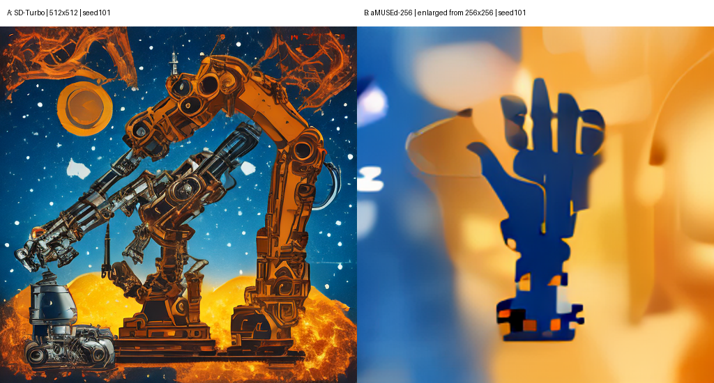

## Лабораторная работа №10
Сравнительное исследование моделей text-to-image

Вариант 3. Власюк Данил Витальевич
Группа Т26ИИКТ-МИК11
11 ноября 2026 года

## Цель и постановка

Сравнить конфигурации SD-Turbo и aMUSEd-256 на одном брифе, отделить разброс seed от практического эффекта и сопоставить численные показатели со слепым визуальным выбором. Сравниваются конфигурации целиком: причинный эффект архитектуры отдельно не определяется.

## Гипотеза и допуски до запуска

# Предварительный протокол ЛР10, вариант 3

A: SD-Turbo, 1 шаг, guidance0, 512x512. B: aMUSEd-256, 12 шагов, guidance10, 256x256. Ревизии из методички, float32 CPU, 4 потока, seed101-105. Один бриф робототехники. CLIP ViT-L/14. Edge и contrast после resize256. Время без загрузки и после прогрева seed0.

H1: aMUSEd уступит SD-Turbo по clip_brief более чем на 1 пункт. H2: clip_text у aMUSEd выше более 1 пункта. H3: B медленнее A хотя бы в 1.5 раза. Для edge/contrast направление не предсказывается; допуск10% среднего A. Для обеих CLIP-метрик допуск1.0. Признак |delta|>2s_A отдельно от практического допуска, не формальный тест.

Слепая оценка: сначала осмотреть только blind_101…105, записать сторону и причину; потом открыть ключ. Оценщик - ИИ-ассистент, выполняющий работу по поручению студента; это не независимая человеческая экспертиза. Пять пар не доказывают превосходства на уровне0.05, даже5:0 даёт p=0.0625. Размер кадра может раскрывать семейство косвенно.

2026-11-11T16:51:08.305849+03:00

## Данные и методика

editorial poster concept for a robotics festival, glowing mechanical arm silhouette, deep blue and amber palette, clean composition, no text, no logo, no people

Обе конфигурации выполнены последовательно в одном сеансе Engee на CPU float32, 4 потока. Общие seed101-105. Загрузка и прогрев seed0 исключены из seconds. CLIP ViT-L/14 оценивает собственное разрешение изображений; edge/contrast рассчитаны после resize256. Результаты метрик сохранены до сжатия JPG; для проверки приложены PNG без потерь. Для слепых листов использованы JPG quality90, размер384 и зазор12, как в приложении методички.

## Численные результаты

| Метрика | A | s_A | B | Δ | ∣Δ∣/s | >2s |
| --- | --- | --- | --- | --- | --- | --- |
| clip_brief | 25.1653 | 0.8040 | 27.8745 | 2.7092 | 3.3695 | да |
| clip_text | 12.3973 | 0.9435 | 15.1073 | 2.7100 | 2.8724 | да |
| edge | 0.0527 | 0.0039 | 0.0204 | -0.0323 | 8.3620 | да |
| contrast | 0.1750 | 0.0171 | 0.2575 | 0.0824 | 4.8245 | да |
| seconds | 25.4231 | 1.8006 | 45.2441 | 19.8210 | 11.0077 | да |
clip_brief: критерий2s=True, практический допуск превышен=True. Абсолютный допуск=1.00000.

clip_text: критерий2s=True, практический допуск превышен=True. Абсолютный допуск=1.00000.

edge: критерий2s=True, практический допуск превышен=True. Абсолютный допуск=0.00527.

contrast: критерий2s=True, практический допуск превышен=True. Абсолютный допуск=0.01750.

seconds: критерий2s=True, практический допуск превышен=True. Допуск времени: отношение1,5.

Среднее время B/A=1.780. Время относится только к этим последовательным вызовам на CPU Engee; фоновая нагрузка и порядок запуска могут влиять. CLIP не измеряет эстетику, OCR и техническую правильность.

## Слепое сравнение

| Seed | Выбор | Обоснование |
| --- | --- | --- |
| 101 | left | The industrial mechanical arm is clearer on the left; the right has a detached hand shape, although its composition is cleaner. |
| 102 | right | The right shows a recognizable robotic manipulator and avoids the prominent letter-like marks on the left. |
| 103 | right | The right has a central hand silhouette and cleaner composition; the left makes a humanoid robot the main subject. |
| 104 | right | The right has a recognizable industrial arm; the left shows a blurred humanoid and large pseudo-letters. |
| 105 | right | The right has a clearer mechanical arm and appropriate palette; the left is blurred with letter-like marks near the bottom. |
## Итог слепого сравнения

Выбор записан 11.11.2026 после просмотра только blind_101-105, до отображения содержимого ключа; SHA-256 записи сохранён в blind_choice_sha256.txt. Файл ключа был технически скопирован вместе с архивом, но его содержимое оценщику до записи выбора не показывалось.

После раскрытия: seed101 - turbo, 102 - turbo, 103 - amused, 104 - turbo, 105 - turbo. Итого SD-Turbo 4, aMUSEd 1. Это наблюдение ИИ-оценщика на пяти парах, а не доказанное превосходство. Двусторонняя биномиальная вероятность для результата не менее крайнего, чем4:1, при p=0.5 равна0.375. Даже5:0 дало бы0.0625>0.05.

Оценку выполнил ИИ-ассистент по поручению студента. Это не независимое исследование с людьми; изображения разных разрешений и стиль могут частично раскрывать семейство модели. Ключ прочитан после сохранения выбора; даты и SHA-256 зафиксированы.

## Визуальное сопоставление seed101

На seed101 SD-Turbo показывает сложный промышленный манипулятор на тёмно-синем фоне с янтарными деталями. Рука узнаваема и занимает большую часть кадра; вокруг много декоративных элементов, поэтому требование чистой композиции выполнено лишь частично. aMUSEd показывает центральную тёмно-синюю кисть на жёлто-янтарном фоне: силуэт проще и чище, но связь с промышленной роботизированной рукой менее очевидна, детали условные и размытые.

В серии aMUSEd на seed102/104/105 заметны крупные буквоподобные элементы вопреки no text; на104 вместо руки доминирует гуманоидная фигура. У SD-Turbo на103 тоже доминирует гуманоид, что объясняет выбор aMUSEd именно в этой паре. Ни одно изображение не следует считать чертежом реального устройства. Названия производителей не вводились.

aMUSEd получает более высокий clip_brief, но слепой выбор чаще отдаёт предпочтение SD-Turbo. CLIP может оценивать плакатную композицию, цвета и сходство с рукой, не учитывая инженерную правдоподобность. Рост clip_text согласуется с заметными псевдобуквами, но эта проба не является OCR. Более низкая энергия границ aMUSEd согласуется с упрощёнными и размытыми формами; более высокий контраст яркости не равен более качественной детализации.

## Вывод и ограничения

H1 не подтвердилась: aMUSEd не уступила по clip_brief, а превысила SD-Turbo на2.7092 пункта, выше допуска1.0 и порога2s_A. H2 подтвердилась для данной серии: clip_text вырос на2.7100 пункта, также выше обоих порогов. H3 подтвердилась: среднее время45.244с против25.423с, отношение1.780>1.5, без загрузки и прогрева.

Edge снизился на61.25%, contrast вырос на47.10%; оба изменения превышают допуск10% и2s_A, но сами по себе не означают улучшения дизайна. Все пять метрик превышают эвристический порог2s_A и заданные практические допуски. Классификация ведётся по двум независимым признакам: они могут выполняться одновременно.

Для данного брифа практический выбор - SD-Turbo: она быстрее и выиграла4 из5 слепых пар ИИ-оценки. Это не универсальный рейтинг моделей. Если целью конвейера является именно CLIP-сходство, преимущество aMUSEd по этому показателю следует учитывать отдельно; его цена - большее время и более частые буквоподобные артефакты. Лицензия, визуальный контроль и требования заказчика остаются частью выбора.

Один бриф, пять seed, две конфигурации, один сеанс CPU. Эвристика2s не является формальным тестом значимости. Равные номера seed не дают одинаковых внутренних случайных величин разным семействам. aMUSEd использует маскированные токены; число шагов не эквивалентно диффузионному. Размер кадра - часть конфигурации, а resize не устраняет все различия. CLIP может усекать длинный запрос; отрицания понимает слабо.

## Паспорт

Начало: 2026-11-11T13:53:32+0000; Python 3.11.11 (main, Mar 17 2025, 21:02:09) [Clang 20.1.0 ]; Linux-6.8.0-117-generic-x86_64-with-glibc2.35

Пакеты: {"torch": "2.4.1+cpu", "diffusers": "0.32.2", "transformers": "4.57.6", "numpy": "2.1.3", "scipy": "1.15.2", "Pillow": "11.1.0"}

CPU float32, потоки=4; seed=[101, 102, 103, 104, 105]

Конфигурации и ревизии: {"turbo": {"repo": "stabilityai/sd-turbo", "revision": "b261bac6fd2cf515557d5d0707481eafa0485ec2", "steps": 1, "guidance": 0.0, "size": 512}, "amused": {"repo": "amused/amused-256", "revision": "09b6259bf96dbe6d70a852b70812420fe02df55e", "steps": 12, "guidance": 10.0, "size": 256}}

CLIP openai/clip-vit-large-patch14, ревизия 32bd64288804d66eefd0ccbe215aa642df71cc41

SHA-256 сценария: 0619146f547990ff322c2db1c4fd6c5bd2066431c88fc59a2ff54a139d8eebbe

Engee 26.10.2-H3. Конфигурации планировщиков сохранены отдельно в turbo_scheduler.json и amused_scheduler.json. Время загрузки не включалось в метрику seconds; повторный независимый полный прогон не выполнялся.

## Происхождение и лицензии

# Источники и происхождение

Методика и конфигурации: приложенные МУ ЛР10, приложение А, стр.30-33. ZIP на странице do.skif задания159542 отсутствовал на момент работы; execute_lr10.py - собственная реализация варианта3 по опубликованным функциям, не побитовая копия отсутствующего lab10_lib.py. Добавлены сохранение per-seed JSON, PNG без потерь и паспорт; JPG quality90 и слепые листы соответствуют методичке.

Карточки просмотрены 11.11.2026:
- https://huggingface.co/stabilityai/sd-turbo — исследовательский артефакт; карточка направляет коммерческое использование на https://stability.ai/license. Условия Stability AI; не следует считать веса общедоступной лицензией без ограничений.
- https://huggingface.co/amused/amused-256 — OpenRAIL++; маскированные токены, не диффузия.
- https://huggingface.co/openai/clip-vit-large-patch14 — измерительный CLIP; ограничения и intended use в карточке. Код CLIP: https://github.com/openai/CLIP (MIT).

Точные ревизии закреплены в сценарии и паспорте. Учебные результаты не предполагают разрешение на коммерческую публикацию или распространение весов. Перед внешним использованием проверяются условия конкретной ревизии, ограничения использования, уведомления и права на результат. Веса не входят в комплект.

## Контрольные вопросы

1. Сравниваются конфигурации целиком: веса, планировщик, шаги, guidance, размер. LCM с одним шагом - другой объект сравнения, он может дать худший результат из-за сокращённого режима.
2. |Δ|>2s_A - сравнение средних с разбросом A, не p-value. При пяти seed небольшое устойчивое различие может не пересечь порог; правило консервативно.
3. Пространственный масштаб влияет на производные и контраст; resize256 уменьшает смешение размера с метрикой. Интерполяция также влияет на детали и не делает модели полностью сопоставимыми.
4. Загрузка оценивает сеть и кэш, а не вызов генерации. Прогрев уменьшает влияние первой инициализации вычислений. Время всё равно зависит от нагрузки CPU и относится только к одному сеансу.
5. CLIP измеряет сходство с текстом, а не эстетику и отсутствие дефектов. Следует сообщить оба результата и расхождение без объявления модели лучшей вообще.
6. clip_text - сходство с фразой written text and letters. Оно чувствительно к буквоподобной структуре и стилю, не локализует и не распознаёт текст, допускает ложные срабатывания.
7. Случайный порядок уменьшает позиционное предпочтение; закрытый ключ уменьшает ожидания от названия модели. Знание характерных артефактов и разрешения может частично раскрывать модель.
8. При равновероятном выборе вероятность двух крайних исходов - 2*(1/2)^5=0.0625>0.05. Даже5:0 недостаточно для отклонения равенства на этом уровне.
9. Шаг aMUSEd - уточнение маскированных токенов, а не диффузионное удаление шума. Равенство числа шагов не означает равной вычислительной работы. Guidance и размер сохраняют операционный смысл, но их эффект не эквивалентен разным семействам.
10. Нельзя обобщить: один бриф, пять seed, конкретные конфигурации и CPU-среда. Отдельный фактор архитектуры этим опытом не изолирован.
11. Проверяются точная ревизия и текст лицензии, разрешённые сценарии, коммерческое использование, запрещённое применение, атрибуция и распространение, применимость условий к результатам. Доступность весов не означает отсутствие ограничений.
12. Для данного брифа и конвейера можно предпочесть более быструю конфигурацию при приемлемой визуальной оценке и лицензии. Отсутствие эффекта CLIP не доказывает равного качества для других задач.

## Комплект для сдачи

ЛР10_Вариант_3_Сдача.zip: сценарий, выполненный ноутбук, отчёты PDF/Markdown, паспорт, per-seed данные, PNG/JPG, пять слепых листов и ключ, зафиксированный выбор, журналы и проверка. Веса моделей не включены. Загрузка на do.skif не выполнялась.
