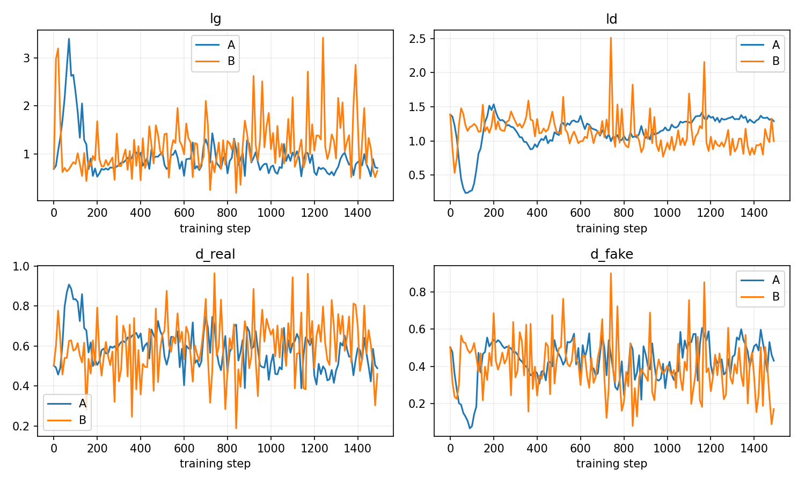
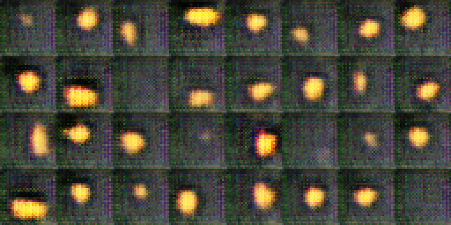
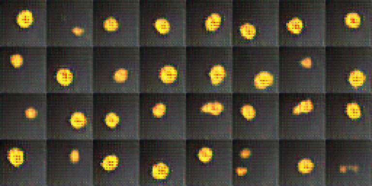

## Лабораторная работа №11. Базовая GAN

Власюк Данил Витальевич, Т26ИИКТ-МИК11. Вариант 3.
Собственный эксперимент: 2026-11-19T04:49:34.722953+00:00 (UTC).

## Цель и гипотеза

Обучить GAN на синтетических сценах с диском и проверить влияние повышения скорости обучения обеих сетей с 0.0002 до 0.001.
# Протокол основного эксперимента Engee

2026-11-19T04:48:05.890456+00:00

Вариант3: диск, lr обеих сетей 0.0002 → 0.001. Гипотеза: повышенный lr может ухудшить nn_psnr и coverage, diversity может отдалиться от1. Допуски0.5 дБ,0.10,0.05 соответственно. Проверяем |Δ|>2s_A отдельно от практического эффекта. Seed101–105,1500шагов,batch64,4потока,CPU.

Перед этим проводилась локальная проба, остановленная по просьбе пользователя. Её данные исключены из комплекта сдачи. Гипотеза не меняется, но опыт пробы мог повлиять на ожидания; новая серия Engee начинается после этой записи.

## Данные и архитектура

4096 обучающих и 1024 тестовых сцены 32×32×3 из lab07_lib.py. Генератор: z=32, Linear до 64×4×4, ConvTranspose 64→32→16→3, BatchNorm и ReLU, выход Sigmoid. Дискриминатор: Conv 3→16→32→64, LeakyReLU(0.2), Linear до логита; без BatchNorm. Adam: beta1=0.5, beta2=0.999, batch64, 1500 пар обновлений, ненасыщающая потеря G. Между A и B меняется только lr_g и lr_d.

## Среда и выполнение

Фактический запуск выполнен в Engee 26.10.2-H3 на CPU. Python 3.11.11, PyTorch 2.4.1+cpu, NumPy 2.1.3, потоки 4.
Команда: python3 -u LR11/src/execute_lr11.py. Все десять обучений выполнены; метрики и история каждого запуска сохранены отдельно. Гипотеза и допуски записаны до запуска основной серии Engee; перед этим была остановленная локальная проба, исключённая из сдаваемых результатов. Опыт пробы мог повлиять на ожидания.
Время seed101 включает callbacks сохранения снимков; остальные времена не включают их. Поэтому seconds - эксплуатационный замер, а не чистый контролируемый тест производительности.

## Методика метрик

1024 подделки и 1024 тестовые сцены. nn_psnr: среднее 10log10(1/MSE) до ближайшей тестовой сцены. coverage: доля тестовых сцен, в шар радиуса до 20-го тестового соседа которых попала подделка. diversity: среднее попарное расстояние подделок / такое же тестовых сцен. s_A выборочное по пяти seed. Эвристика |Δ|>2s_A не заменяет проверку статистической значимости. Для diversity учитывается близость к 1, а не просто рост.

## Результаты

Собственные результаты десяти обучений приведены ниже. Порог практического изменения не означает автоматически улучшение качества.

| Метрика | Среднее A | s_A | Среднее B | Δ | ∣Δ∣/s_A | >2s_A | >допуск |

| --- | --- | --- | --- | --- | --- | --- | --- |

| nn_psnr | 20.2743 | 0.8837 | 22.6551 | 2.3807 | 2.6941 | да | да |

| coverage | 0.7598 | 0.2866 | 0.9836 | 0.2238 | 0.7810 | нет | да |

| diversity | 0.9054 | 0.0235 | 0.9230 | 0.0175 | 0.7473 | нет | нет |

| seconds | 94.4642 | 5.7917 | 93.0016 | -1.4626 | 0.2525 | нет | не задан |

## Оценка гипотезы

Получены Δnn_psnr=+2.3807 дБ, Δcoverage=+0.2238, Δdiversity=+0.0175. Гипотеза ухудшения PSNR не подтвердилась: B выше A. Гипотеза снижения охвата не подтвердилась. Расстояние diversity до 1: A=0.0946, B=0.0770.

## Потери и качество

На последних десяти зарегистрированных точках seed101 средняя потеря G: A=0.7811, B=1.0471; D: A=1.3185, B=0.9961. Сравнение относится к одному seed, а таблица - к пяти. Значения потерь описывают игру с текущим D и не являются оценкой качества изображения. Изменение PSNR необходимо рассматривать вместе с coverage, diversity и визуальными артефактами.

## Справочные данные преподавателя

Приложенная сводка results_30_summary.txt, вариант3: nn_psnr A20.22/B22.27, coverage A0.786/B0.980, diversity A0.917/B0.933. Это чужой прогон Engee от 20.09.2026, не результат данного запуска. Приложенный demo11_sheet.png относится к варианту1 (размерность шума), поэтому он не использован как собственный лист варианта3. Различия с новым прогоном возможны из-за PyTorch, платформы и численной траектории обучения.

## Визуальная оценка

На финальном листе A видны диски разных положений и размеров, но часть из них вытянута или размыта. Фон имеет выраженную цветную сетчатую текстуру; некоторые слабые диски трудно отделить от фона. В B диски в целом компактнее, контуры и контраст читаются лучше, фон ровнее, хотя пиксельная сетка и искажения контура остаются. На обоих листах меняются положение и размер, явного повторения единственного изображения нет; это визуальное наблюдение на 32 образцах seed101, а охват всей тестовой выборки оценивается отдельно.

## Ограничения и вывод

Сравнены две конфигурации на одной простой сцене и пяти seed. Нельзя переносить вывод на естественные изображения или считать lr=0.001 универсально лучшей настройкой. Пиксельные метрики не оценивают семантику. Парные seed не устраняют все различия траекторий. Обучение не повторено вторым независимым полным прогоном. Для уверенной оценки времени нужно исключить callbacks и контролировать нагрузку. Цель работы выполнена: GAN обучена, динамика и разнообразие измерены, эффект lr сопоставлен с разбросом и практическими допусками. Версии среды приведены в паспорте.

## Паспорт и источники

Полный паспорт: artifacts/passport.json; конфигурации, SHA-256 кода и seed сохранены. Архив: ЛР11_Вариант_3_Сдача.zip. Источники: приложенная методичка ЛР11, src11.zip и lab07_lib.py из ЛР7. Синтетические сцены порождаются кодом, внешние изображения не загружались. Отдельная лицензия на присланный учебный код не приложена; отсутствие внешнего датасета само по себе не задаёт лицензию кода. Общедоступные источники из методички: Goodfellow et al. arXiv:1406.2661; Radford et al. arXiv:1511.06434; Naeem et al. arXiv:2002.09797.

## Ответы для защиты

1. D минимизирует -E log D(x) - E log(1-D(G(z))); G в ненасыщающей постановке минимизирует -E log D(G(z)). Обновления чередуются; на шаге D подделки отсоединены от графа G.
2. Когда D(G(z)) близко к нулю, исходная минимаксная log(1-D(G(z))) даёт слабый градиент по логиту. Для проверки нужен отдельный фактор потери (вариант 6); вариант 3 этого не проверяет.
3. Падение потери G означает улучшение относительно текущего D; качество и разнообразие подтверждаются образцами и отдельными метриками.
4. nn_psnr измеряет близость каждой подделки к ближайшему тестовому образцу. coverage измеряет охват тестовых сцен. Повтор одного реалистичного диска может дать высокий PSNR при низком охвате.
5. Для короткого обучения и трёх факторов 5-й сосед даёт слишком маленькие шары; 20-й делает coverage чувствительнее. Значения с разными k напрямую несопоставимы.
6. diversity<1 указывает на меньший разброс, возможное схлопывание; >1 может означать лишний шум. Ровно 1 не гарантирует реалистичности.
7. lr и beta1 зависят от данных, архитектуры и длины обучения. Предупреждение DCGAN не является универсальным законом для учебной сцены.
8. Одинаковый знак на пяти seed - направленная тенденция. Если |Δ|≤2s_A, эвристический порог не превышен; практическую пользу проверяют отдельно.
9. Снимки показывают переход от шума к структуре, временные колебания и возможное позднее схлопывание.
10. Версии библиотек, аппаратная платформа, порядок операций с плавающей точкой и параллелизм могут менять траекторию. Нужны несколько seed, паспорт и допуски вместо требования побитового совпадения.
11. Нужны пять seed для каждого режима, общие train/test, архитектура, batch, число шагов, потоки и версия кода, четыре метрики, журналы и листы образцов. Меняется только выбранный фактор.

