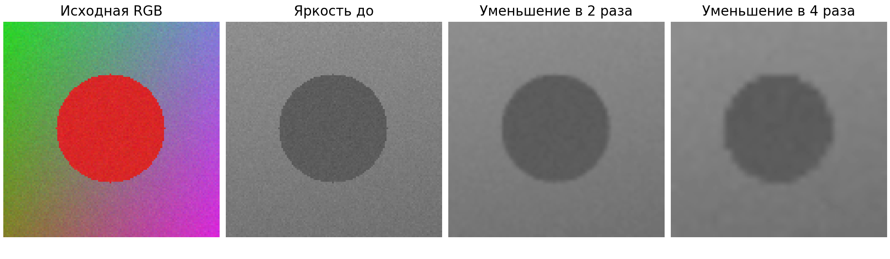
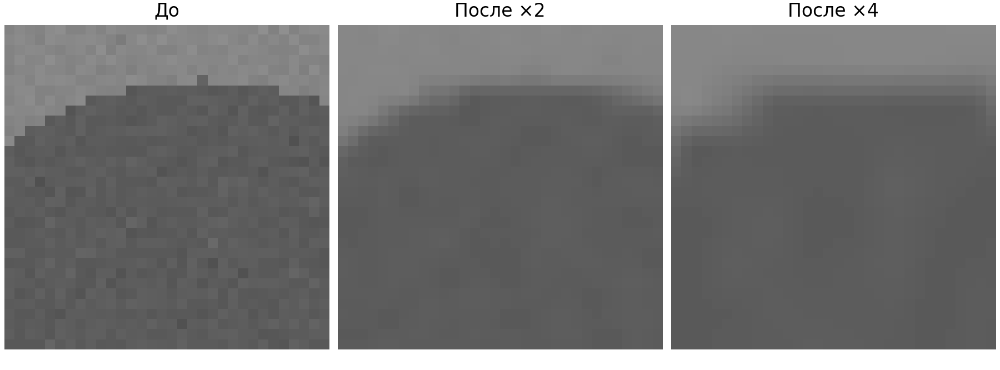
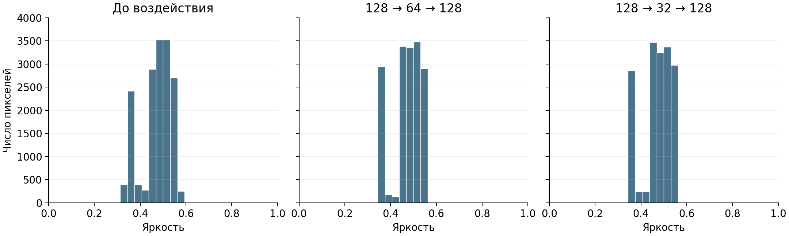

# Лабораторная работа 3 Подготовка изображений и визуализация в Engee

**Вариант 3.** Уменьшение изображения в четыре раза и возврат к исходному размеру.

Власюк Данил Витальевич, группа Т26ИИКТ-МИК11. 7 октября 2026 года.

## 1 Цель и методика эксперимента

Цель работы — описать цифровое изображение, сравнить два способа получения яркости и измерить потери после изменения размера. Для варианта 3 выполнено уменьшение базовой сцены 128×128 до 32×32 и восстановление до 128×128. Сравнительный режим — уменьшение до 64×64. По пяти seed практический порог пересекла только энтропия; средний PSNR составил 35,24 дБ.

### Постановка и данные

Вариант N=(1−1)×6+3=3: сцена 1 и фактор 3. Синтетическая сцена содержит диагональные градиенты каналов RGB, круг и гауссов шум. Параметры: n=128, lo=0.15, hi=0.85, noise=0.02, checker=0. Серия seed — 101, 102, 103, 104, 105. Все случайные значения берутся из локального MersenneTwister(seed). Изображения людей и внешние произведения не использовались.

### Гипотеза и допуск до запуска

07.10.2026 в 20:23:23 MSK, до старта в 20:32:24 MSK, записано: средняя яркость изменится менее чем на 5%, контраст и энтропия снизятся, а PSNR при уменьшении вчетверо будет ниже, чем вдвое. Дополнительная серия при noise=0 проверяет, сохраняются ли потери без шума.

Практический критерий по каждой метрике: |Δ|/|base|>0.05; по изображению: средний PSNR<30 дБ. 5% — учебный допуск относительного сдвига, а 30 дБ соответствует MSE=0.001 для [0,1]. Оба порога условны и не заменяют визуальную оценку. Учебный статистический критерий — |Δ|>2s, где s — выборочный разброс базовой метрики между seed; это эвристика методички без заданного уровня p.

### Среда и порядок расчёта

Фактическая среда: Engee 26.9.2-H4; Julia 1.12.4; Linux x86_64; Images 0.26.2; Plots 1.41.6. Библиотека lab03_lib.jl от 19.09.2026 сохранена без изменений. Расчёт выполнен в /user/AI_in_creative_media/LR03, исходный вывод сохранён в ngscript и run_output.txt.

```julia
include("lab03_lib.jl")
g = luma_images(make_scene(101; scene_preset(1)...))
h = apply_factor(g, 3)
variant_summary(3)
```

Используются mean, std с corrected=true, энтропия 32 равных интервалов [0,1] и PSNR=10log10(1/MSE), MSE=mean((g−h)²). Сначала рассчитываются массивы Float64, затем отдельно сохраняются PNG N0f8 для просмотра. Поэтому экспортное квантование не входит в потери воздействия.

## 2 Свойства сцены и воспроизводимость

| Свойство | Значение |
| --- | --- |
| Размер RGB и яркости | 128×128 |
| Тип цветного пикселя | RGB{Float64} |
| Диапазон каналов RGB | 0.08115622264322489 … 0.9185814096363565 |
| Объём RGB | 393216 байт = 128×128×3×8 |
| Объём яркости Float64 | 131072 байта = 128×128×8 |
| Промежуточный размер варианта 3 | 32×32; в 16 раз меньше отсчётов |
| Возвращённый размер | 128×128 |

Ручная яркость вычислена как 0.299R+0.587G+0.114B, стандартная — Float64.(Gray.(img)). Максимум абсолютной разности равен 9.856187532797378×10⁻⁹; допуск 10⁻⁷ соблюдён. Это численное совпадение с допуском, а не побитовое равенство.

SHA-256 стандартной яркости seed 101 при двух независимых построениях сцены совпал:

```text
50567c6b9e5e4ac1b068d288afc484e1918714e92d7ec350c63efb1d20bfcfc6
```

Хеш рассчитан по Float64 в порядке vec Julia по столбцам, little-endian. Полная 64-символьная сумма записана в паспорте; исходный массив сохранён как before_seed101.f64. Контрольная сумма PNG отличается, поскольку у него другая структура и точность данных.

Рисунок 1 — сцена seed 101 и два режима обработки



Рисунок 2 — фрагмент границы круга, строки 27–58 и столбцы 45–76



## 3 Результаты варианта 3

Средние рассчитаны по пяти seed. s характеризует разброс базовой метрики между seed, а контраст — std по пикселям одного изображения. Эти две величины имеют разный смысл.

| Метрика | База | s | После | Δ | Модуль Δ / s | >2s |
| --- | --- | --- | --- | --- | --- | --- |
| Среднее | 0.471942 | 8.389e-05 | 0.471452 | -0.000490 | 5.842 | Да |
| Контраст | 0.064246 | 1.540e-04 | 0.061669 | -0.002577 | 16.737 | Да |
| Энтропия бит | 2.687328 | 4.444e-03 | 2.486132 | -0.201196 | 45.277 | Да |

Рисунок 3 — гистограммы исходных Float64, 32 интервала, seed 101



### Оценка каждой метрики

Средняя яркость снизилась с 0.471942 до 0.471452: Δ=−0.000490, относительное изменение 0.104%. Критерий 2s выполнен (5.842s), практический допуск 5% соблюдён. Значительного общего затемнения по этому допуску нет.

Контраст снизился с 0.064246 до 0.061669: Δ=−0.002577, изменение 4.011%. Критерий 2s выполнен (16.737s), практический допуск 5% соблюдён. Потеря контраста есть, но меньше заранее выбранного порога.

Энтропия снизилась с 2.687328 до 2.486132 бит: Δ=−0.201196 бит, изменение 7.487%. Критерий 2s выполнен (45.277s) и практический порог 5% превышен. На гистограмме шумовые значения концентрируются в более узких группах.

Средний PSNR пяти seed равен 35.244413 дБ, выборочный разброс 0.073074 дБ; диапазон 35.141812…35.298577 дБ. Все значения выше 30 дБ. По принятому порогу суммарная MSE остаётся допустимой, хотя граница круга визуально сглажена.

## 4 Сравнение масштабов и контроль шума

| Режим | Среднее | Контраст | Энтропия бит | PSNR дБ |
| --- | --- | --- | --- | --- |
| Исходный | 0.471942 | 0.064246 | 2.687328 | — |
| 128 → 64 → 128 | 0.471942 | 0.061871 | 2.437457 | 36.874023 |
| 128 → 32 → 128 | 0.471452 | 0.061669 | 2.486132 | 35.244413 |

При уменьшении вдвое средняя яркость сохраняется с точностью округления; критерий 2s для неё не выполнен. Контраст снижается на 3.697% (15.425s), энтропия — на 9.298% (56.230s). Практически изменяется только энтропия. Средний PSNR выше результата ×4 на 1.629610 дБ.

Более сильное уменьшение снижает PSNR и контраст, однако энтропия после ×4 выше, чем после ×2, на 0.048675 бит. Энтропия фиксированных интервалов описывает распределение яркости, а не пространственное качество: интерполяция границ создаёт промежуточные значения. Поэтому энтропию нельзя ранжировать как универсальную меру сохранённых деталей.

### Пять запусков основного воздействия

| Seed | Среднее после | Контраст после | Энтропия после | MSE | PSNR дБ |
| --- | --- | --- | --- | --- | --- |
| 101 | 0.471380 | 0.061651 | 2.470987 | 2.952e-04 | 35.298577 |
| 102 | 0.471698 | 0.061698 | 2.499279 | 3.061e-04 | 35.141812 |
| 103 | 0.471196 | 0.061884 | 2.492604 | 2.954e-04 | 35.295650 |
| 104 | 0.471300 | 0.061638 | 2.481791 | 2.955e-04 | 35.294341 |
| 105 | 0.471685 | 0.061476 | 2.486000 | 3.026e-04 | 35.191684 |

### Контроль при отсутствии шума

| Шум | Режим | Средняя MSE | Средний PSNR дБ |
| --- | --- | --- | --- |
| 0.02 | ×2 | 0.000205413 | 36.874023 |
| 0.02 | ×4 | 0.000298957 | 35.244413 |
| 0 | ×2 | 0.000057993 | 42.366227 |
| 0 | ×4 | 0.000114540 | 39.410417 |

Без шума ошибка снижается, но не исчезает; ×4 по-прежнему даёт худший PSNR. Это подтверждает вклад структуры сцены, в том числе резкой границы круга, а не только сглаживания шума. При noise=0 все seed дают одинаковые данные и s=0: критерий |Δ|/s здесь не применяется. Эта серия служит диагностикой, а не пятью независимыми наблюдениями.

## 5 Анализ ограничений и вывод

### Чувствительность к практическому допуску

При исходном пороге 5% практически значима только энтропия. Для проверки чувствительности, без изменения основного решения, при пороге 3% значимы контраст и энтропия; при 10% ни одна из трёх метрик его не пересекает. Средняя яркость сдвинулась лишь на 0.104%. При PSNR-пороге 30 дБ оба режима допустимы; при более строгом 36 дБ режим ×4 пересёк бы порог, а ×2 — нет. Поэтому порог должен следовать из задачи и фиксироваться до расчёта.

### Границы интерпретации

Критерий 2s сравнивает сдвиг с вариативностью базовой сцены. Он не учитывает распределение парных разностей, не задаёт уровень ошибки первого рода и не является формальным тестом с p<0.05. В отчёте «статистически значимо» означает только выполнение учебного критерия. Пять seed меняют реализацию шума одной сцены, а не представляют выборку из разных изображений.

Вывод ограничен синтетической сценой и штатной imresize с параметрами по умолчанию в данной версии Images. Другие изображения, интерполяция, шум или границы изменят результат. Глобальные среднее, std и энтропия могут скрыть локальную потерю деталей; PSNR измеряет численное отличие и не оценивает красоту или читаемость текста. Фиксированная разбивка гистограммы влияет на энтропию.

Контроль без шума показал ненулевые потери на структуре сцены. Более сильное уменьшение не обеспечило монотонного изменения энтропии: она зависит от перераспределения значений по интервалам. Для следующей проверки можно взять собственную фотографию тестовой таблицы с тонкими линиями и текстом, подтвердить авторство, сохранить оригинал и повторить оба масштаба при тех же критериях; отдельно оценить читаемость деталей.

### Проверки выполнения

Подтверждены диапазон [0,1], размер 32×32 после уменьшения, возврат 128×128, совпадение двух хешей, численное совпадение способов яркости и воспроизведение демо. Независимый verify_results.py пересчитал сводку из CSV, хеши Float64 и PSNR по сохранённым массивам; RESULT PASS. Библиотека преподавателя совпала с исходником по байтам. Исполненный ngscript содержит сохранённый stdout и не содержит ошибок.

### Вывод

Предварительная гипотеза подтверждена: средняя яркость меняется слабо, контраст и энтропия снижаются, а уменьшение вчетверо даёт меньший PSNR, чем вдвое. В варианте 3 все три метрики пересекают учебный порог 2s, но только снижение энтропии на 7.487% превышает практический порог 5%. Средний PSNR 35.244413 дБ остаётся выше 30 дБ. Возврат исходного размера не восстанавливает утраченные детали; оценку качества следует дополнять осмотром границ и деталей.

## 6 Контрольные вопросы

### 1 Объём массива

256×256×3×8 = 1 572 864 байт для RGB{Float64}. RGB{N0f8} занимает 196 608 байт, то есть в 8 раз меньше. Это полезные данные массива, а не размер PNG на диске и не полный расход памяти со служебными структурами.

### 2 Два способа яркости

Gray использует коэффициенты с иной внутренней точностью и порядком арифметики; Float64 также имеет конечную точность. Поэтому побитовое совпадение не гарантируется. Сравнивать следует максимум абсолютного отклонения или isapprox с заранее заданным atol=1e-7, rtol=0. SHA применяется к повтору одного и того же способа расчёта.

### 3 PSNR

При MSE=4×10⁻⁴: 10log10(2500)=33.9794 дБ. При уменьшении MSE вдвое PSNR возрастает на 10log10(2)=3.0103 дБ, до 36.9897 дБ.

### 4 Энтропия после 4 бит

Возможны только 16 значений; в гистограмме из 32 интервалов не более 16 ненулевых частот. H≤log2(16)=4 бит, равенство достигается при одинаковых вероятностях всех 16 уровней.

### 5 Малый разброс

Между seed меняется только слабый шум, а структура сцены остаётся прежней. Метрики усредняют 16 384 пикселя, поэтому их разброс мал. Даже небольшой устойчивый сдвиг может превысить 2s. Это учебная эвристика, а не p-значение и не доказательство визуальной важности.

### 6 Два вида значимости

Чисто числовой пример: Δ=0.001 при s=0.0001 превышает 2s, но составляет лишь 0.2% от базовой метрики 0.5 и укладывается в допуск 5%. Обратный пример: Δ=0.04 при s=0.03 составляет 8% от 0.5, но не превышает 2s. Эти примеры иллюстративные; результаты лабораторной рассматриваются отдельно.

### 7 Гамма и растяжение

Растяжение линейно переводит исходный диапазон в [0,1]. Гамма x^γ действует нелинейно: при γ=0.5 светлеют промежуточные значения, а расстояния между уровнями меняются неодинаково. При фиксированных интервалах гистограммы обе операции могут менять число отсчётов в интервалах и энтропию.

### 8 Уменьшение и возврат

При уменьшении несколько исходных отсчётов заменяются меньшим числом значений. Разные оригиналы могут дать одинаковый уменьшенный массив, поэтому единственное восстановление оригинала невозможно. Интерполяция строит новые значения из сохранённых; потеря деталей — следствие операции, а не сама по себе ошибка алгоритма.

### 9 Паспорт

Нужны дата, версия Engee и Julia, версии пакетов, неизменённая библиотека и её хеш, параметры сцены, все seed, способ яркости, порядок байтов и элементов хеша, размеры уменьшения и возврата, число интервалов, формулы метрик, статистический критерий и заранее записанный практический допуск. Также нужны код, исходные метрики и артефакты.

### 10 Другой seed

Изменится реализация шума, контрольная сумма и немного метрики; структура сцены сохранится. Сначала проверяют seed, параметры, генератор MersenneTwister, версии и способ яркости. При одном и том же seed повтор должен дать одинаковый хеш; для нового seed одинаковый хеш не ожидается. Затем сравнивают с разбросом серии, не меняя пороги задним числом.


## 7 Паспорт и комплект для сдачи

Студент — Власюк Данил Витальевич, Т26ИИКТ-МИК11. Вариант 3. Дата выполнения — 07.10.2026, Europe/Moscow. Предварительная запись — 20:23:23 MSK; расчёт — 20:32:24…20:32:44 MSK. Серверное время вывода на три часа меньше московского.

Среда — Engee 26.9.2-H4, Julia 1.12.4, Linux x86_64-linux-gnu. Images 0.26.2, Plots 1.41.6; Random, Statistics, SHA, TOML, Tar, Dates, InteractiveUtils — стандартные библиотеки Julia. Автоматические метаданные ngscript указывают IJulia 1.9.3; фактическая версия 1.12.4 подтверждена VERSION и versioninfo в сохранённом stdout.

Исходная библиотека lab03_lib.jl от 19.09.2026 — 5027 байт, без изменений. SHA-256:

```text
cd1622643e7cfe7cc01bb7d8067e4802a76f6a76e9a6833ba4c09c84bb9fa62a
```

Параметры сцены: n=128, lo=0.15, hi=0.85, noise=0.02, checker=0. Seed 101…105, локальный MersenneTwister. Основная цепочка 128 → 32 → 128; сравнительная 128 → 64 → 128. Гистограмма — 32 равных интервала [0,1], индекс min(32,max(1,ceil(Int,v*32))). Яркость Gray Float64; статистический критерий |Δ|>2s; практические пороги 5% и 30 дБ.

Контрольная сумма яркости seed 101 и повтор равны. Полный хеш приведён на странице результатов воспроизводимости и в passport.json. Байтовая схема — Float64 IEEE754, little-endian, vec Julia по столбцам. Изображения сохранены в N0f8 только для просмотра; метрики рассчитаны по Float64. Демонстрация воспроизведена. Итоговая проверка — RESULT PASS.

### Архив артефактов

[Архив для сдачи](../ЛР03_Вариант_3_Сдача.zip) лежит в папке LR3 рядом с README.md. Облачная папка — /user/AI_in_creative_media/LR03. Сдаваемый комплект содержит этот отчёт, исполняемый LR03_3.ngscript с stdout, LR03_3.jl и lab03_lib.jl, PNG до и после, гистограммы, CSV по seed и сводку, исходные Float64, паспорт, гипотезу до запуска и журнал проверки. Полный паспорт доступен в [Markdown](passport.md) и [JSON](passport.json).

В Engee из папки с исходниками:

```julia
include("LR03_3.jl")
```

Независимая проверка локально из LR3:

```bash
python3 scripts/verify_results.py
```

### Источники

1. Методические указания «Лабораторная работа № 3. Подготовка изображений и визуализация в Engee», предоставленный DOCX; разделы 2–9.
2. Архив преподавателя: lab03_lib.jl, variants_lr03.json, журнал демо от 19.09.2026.
3. Собственные результаты Engee от 07.10.2026: per_seed.csv, summary.csv, environment_and_results.toml, versioninfo.txt и сохранённый вывод LR03_3.ngscript.
