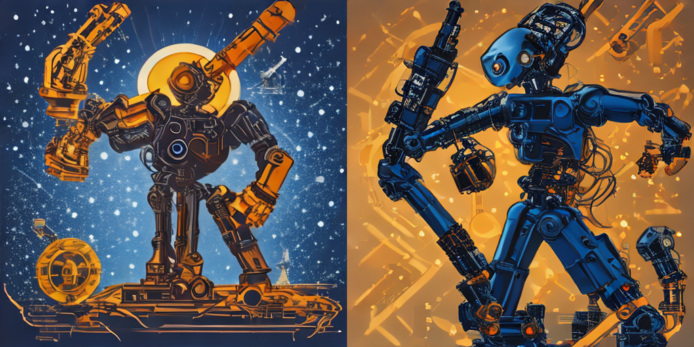

# Лабораторная работа №5 — запуск открытой text-to-image модели

Власюк Данил Витальевич, Т26ИИКТ-МИК11. Вариант 3. Работа выполнена по приложениям к заданию: SD-Turbo, сравнение генераторов CPU/CUDA.

Для сдачи: [выполненный ноутбук с кодом, пояснениями и выводами](notebooks/LR05_3.ipynb) и [полный архив](ЛР05_Вариант_3_Сдача.zip). [Ноутбук в Colab](https://colab.research.google.com/drive/1LLVhl-U3eAhz4oRIyu-yKTtJ3IVGPitm), [отчёт Markdown](reports/ЛР05_Вариант_3_Отчёт.md), [краткое пояснение](reports/ЛР05_Пояснение.md).

26.10.2026 выполнены оба приложенных скрипта и индивидуальный эксперимент на Tesla T4 в Colab. Модель stabilityai/sd-turbo, ревизия b261bac6fd2cf515557d5d0707481eafa0485ec2; seed 1003, 512×512, fp16, 1 шаг, guidance=0. Гипотеза и порог 40 дБ записаны до запуска, контрольная сумма сохранена в reports/pre_run_record.json.

A/B различаются: MSE 7301.234217325847; PSNR 9.496840804095045 дБ; максимальная разность канала 255. Свежий CPU-генератор воспроизводит A точно, общий генератор на два вызова даёт разные изображения. Начальные шумы CPU/CUDA различны ещё до модели; одинаковый явный шум даёт одинаковый результат. Проверки относятся к данной среде и сеансу; отдельный новый сеанс не проверялся.

Бриф выполнен частично: палитра сохранена и механические руки узнаваемы, однако главным объектом стал целый многорукий робот. Изображения — концепты, не схемы реального устройства. Полная визуальная оценка приведена в ноутбуке.

`artifacts/` содержит реальные PNG, манифесты, метрики, начальные тензоры, паспорт и версии. `src/` и `input/` сохраняют исходные скрипты преподавателя без изменений; изображения преподавателя не используются как наши результаты. `data/hypothesis.md` — гипотеза до запуска. `reports/verification.json` — независимая проверка сохранённых результатов.

Локальная проверка после распаковки: `python scripts/verify_results.py` (нужны NumPy и Pillow). Для повторного вычисления открыть ноутбук в Colab, выбрать T4 GPU и Run all; требуется доступ к весам модели. Полный список фактических зависимостей: artifacts/environment.txt. Скрипт build_notebook.py создаёт только новый шаблон в notebooks/prepared/, не заменяя выполненный ноутбук.

Паспорт, архив артефактов и источники оставлены: они подтверждают условия эксперимента, происхождение модели и измерения и требуются методичкой. На учебный портал работа не отправлена — подготовлена для самостоятельной загрузки.
