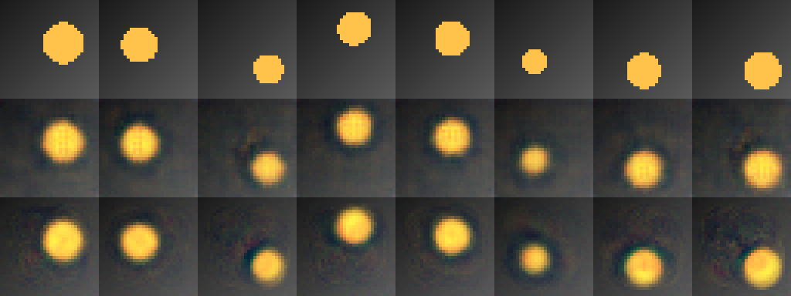

# Лабораторная работа №7: построение автокодировщика

Власюк Данил Витальевич, Т26ИИКТ-МИК11. **Вариант 3**: набор «диск», свёрточная архитектура → полносвязная, латентный вектор d=8.

Для сдачи: [выполненный ноутбук с выводами](notebooks/LR07_3.ipynb), [PDF-отчёт](output/pdf/ЛР07_Вариант_3_Отчёт.pdf), [полный архив](ЛР07_Вариант_3_Сдача.zip). Дополнительно: [Markdown-отчёт](reports/ЛР07_Вариант_3_Отчёт.md), [сравнительный лист](artifacts/comparison.png), [Colab](https://colab.research.google.com/drive/1cc6cHd5HMIcjHXsSgneb_Qh_LbiWAekh).

Фактически выполнено 29.10.2026 в отдельном Colab-ноутбуке на Tesla T4 по приложенной PDF-методичке и скриптам. В карточке задания упоминается Engee, но приложения требуют PyTorch/CUDA в Colab. Материал WorkspaceArray изучен и объяснён в ноутбуке и отчёте.

Демо выполнено целиком без изменения исходников. Основной эксперимент: ConvAE и DenseAE с d=8, Adam lr=0.002, MSE, 20 эпох, batch=128, seed обучения 101–105. Данные синтетические, фиксированный seed 7: 4096 train, 1024 test, RGB 32×32. Гипотеза и допуски сохранены до обучения. Диагностика ConvAE d=1,2,3,4,8 на seed 101–103 выполнена в демо на том же наборе disc.

Результаты: PSNR A=26,0852 дБ, B=25,6936 дБ, разница −0,3916 дБ — нейтрально по допуску ±1 дБ и критерию 2s. Эталон «средняя картинка» даёт 17,1707 дБ на test; обе модели заметно лучше. Рост gap на 0,0755 дБ превышает 2s, но не допуск ±0,1 дБ. DenseAE содержит в 15,64 раза больше весов (1 580 552 против 101 035), зато обучение быстрее: 1,1141 против 1,7183 с (−35,16%). Это разные ресурсные преимущества, а не однозначная победа одной модели.

Обе сети приближённо сохраняют положение и размер диска, но размывают края и создают ореолы. Нулевое смещение центров не утверждается. По пяти seed и синтетическим сценам вывод не переносится на фотографии. Сравнение не выравнивает число параметров; причина отличий включает архитектуру, ёмкость и оптимизацию. Новый сеанс и локальное повторное обучение отдельно не выполнялись.

`artifacts/` содержит реальные метрики, поизображенные MSE всех seed, данные и факторы сцены, среднюю картинку, исходные float32-реконструкции первых восьми test-сцен seed101, веса A/B seed101, диагностику и паспорт. `input/` и `src/` сохраняют неизменённые скрипты преподавателя. Архивные изображения и таблицы преподавателя не используются как наши результаты. Два файла библиотеки в исходном ZIP побитово одинаковы; используется lab07_lib.py.

Проверка после распаковки: `python scripts/verify_results.py` (нужны NumPy и Pillow; GPU и PyTorch не нужны). Скрипт независимо пересчитывает эталон, PSNR из ошибок, статистику, допуски, число параметров из формул слоёв, проверяет сохранённые пиксели и сравнительный лист. В JSON исходной функции Infinity означает бесконечное отношение при s=0; это не статистическая значимость детерминированного числа параметров.

Повторный запуск: открыть ноутбук в Colab, выбрать T4 GPU и Run all. Исходники и готовые веса в комплекте, внешние веса и данные не требуются. build_notebook.py создаёт только шаблон в notebooks/prepared/; выполненный ноутбук не перезаписывается. Для повторной сборки PDF build_report.py использует Arial/Courier New из системных шрифтов macOS.

На do.skif работа не отправлена. Для сдачи загрузить ноутбук, PDF и comparison.png; архив содержит полный комплект подтверждающих материалов.
