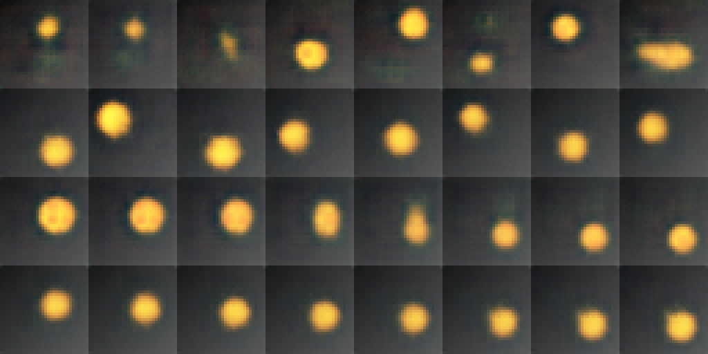

# Лабораторная работа №8: генерация и интерполяция в латентном пространстве

Власюк Данил Витальевич, Т26ИИКТ-МИК11. **Вариант 3**: VAE, размер латентного вектора d=8 → d=2, набор disc.

Для сдачи: [выполненный ноутбук Engee](notebooks/LR08_3.ngscript), [копия Jupyter с теми же выводами](notebooks/LR08_3.ipynb), [PDF-отчёт](output/pdf/ЛР08_Вариант_3_Отчёт.pdf), [полный архив](ЛР08_Вариант_3_Сдача.zip). Дополнительно: [Markdown-отчёт](reports/ЛР08_Вариант_3_Отчёт.md), [снимок консоли](reports/console_summary.png), [журнал выполнения](reports/console_run.log), [основной лист](artifacts/comparison.png), [истинный путь](artifacts/interpolation_true_path.png).

Работа фактически выполнена 29.10.2026 в Engee 26.10.2-H2, Julia 1.12.6, Python 3.11.11, PyTorch 2.4.1+cpu, 4 потока. В Python Engee отсутствовал torch; установлена CPU-версия. Все обучения выполнены на CPU. Отдельная рабочая папка: `/user/AI_in_creative_media/LR08`.

Полностью выполнен неизменённый lab08_demo.py: пять seed β=1/8, диагностика AE/VAE, сравнение без разогрева и с warmup10, демонстрационный лист. Затем выполнен V.variant_summary(3) на seed101–105. d=8, β=1 повторно используется из библиотечного кэша; для d=2 обучены новые модели. Это 26 обучений в сумме, а не подстановка преподавательских чисел. Данные синтетические, внешние веса не используются. Служебный run_lr08.py для пакетной проверки всех шести вариантов сохранён, но не запускался: индивидуальное задание выполнено штатной variant_summary(3).

Основные результаты (A → B): реконструкция 26,3719 → 23,2242 дБ; интерполяция 22,5526 → 22,9795 дБ; сэмплы 23,2418 → 24,4667 дБ; R² факторов 0,89948 → 0,64782. По допуску реконструкция и R² ухудшились, интерполяция нейтральна, близость сэмплов улучшилась. Критерии 2s и практический допуск для этой основной серии согласуются. Улучшение ближайшего соседа не доказывает разнообразия сэмплов.

По отдельным факторам: средний R² радиуса снизился с 0,9440 до −0,00325, а координаты восстановились линейно лучше. В визуальном пути d=2 диск перемещается, но радиус меняется недостаточно. Линейный R² не равен полной оценке информации в нелинейном коде. У d=8 активны 5–8 осей, у d=2 обе оси активны; активность определяется mean KL>0,05 нат.

Демо воспроизвело провал seed102 без warmup: 17,1571 дБ против 26,8770 с warmup10. Средняя train-картинка, заново оценённая на текущем test, даёт 17,1707 дБ. Это согласуется с описанной проблемой схлопывания; один PSNR не исчерпывает диагностику posterior collapse. Для seed101 сэмплы AE β=0 имеют PSNR 12,8617, VAE β=1 — 23,2810.

`src/` и `input/` содержат неизменённые учебные скрипты. Две копии lab08_lib в исходном ZIP побитово совпадают. `src/lr08_execute.py` — собственный сценарий выполнения и сохранения, `data/hypothesis.md` — гипотеза до обучения, `reports/pre_run_record.json` — дата и SHA-256. В `artifacts/` находятся действительные метрики, ошибки, латентные векторы, KL, данные и факторы, регрессионные массивы, веса seed101 и float32-изображения. Преподавательские архивные картинки не выдаются за собственные.

Проверка после распаковки: `python scripts/verify_results.py` (NumPy, Pillow; PyTorch не нужен). Пересчитываются все четыре метрики, регрессия факторов, KL, активные оси, сводная статистика и допуски; сохранённые пиксели и ближайшие соседи проверяются на первых восьми примерах seed101. Обучение локально повторно не выполняется. Результат — PASS; ограничения проверки зафиксированы в reports/verification.json.

Повторное выполнение: подготовить Python CPU со скриптами в отдельной папке Engee, затем выполнить LR08_3.ngscript сверху вниз. scripts/build_workspace.py создаёт шаблон ноутбука и загрузочный помощник в upload/; помощник разворачивает только файлы этой работы. Длительная ячейка вызывает Python, остальные показывают фактические JSON и изображения. Копия .ipynb использует ядро Julia, а не Python. Анализ Markdown добавлен после запуска; код и вычислительные выводы сохранены без изменения. Для сборки PDF build_report.py использует Arial/Courier New из macOS.

На do.skif работа не отправлена. Для сдачи нужны скрипты, ноутбук/журнал, снимок консоли, comparison.png и PDF; полный архив содержит этот комплект. Выводы относятся к одному синтетическому набору, пяти seed и данной среде. Новый сеанс отдельно не проверялся, побитовое совпадение не обещается.
