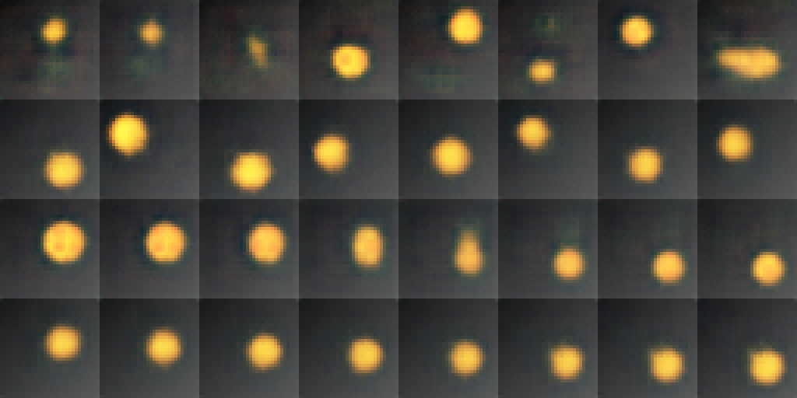
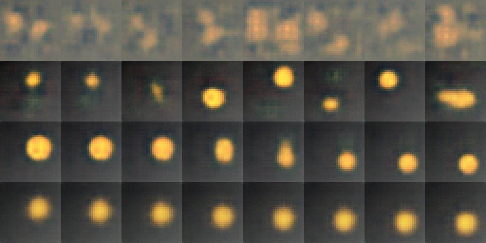

[Выполненный ноутбук Engee](../notebooks/LR08_3.ngscript). [Копия Jupyter](../notebooks/LR08_3.ipynb).

Экспорт фактически исполненного в Engee ноутбука; вывод Python получен вызовом из Julia.

# Лабораторная работа №8. Генерация и интерполяция в латентном пространстве

Власюк Данил Витальевич, Т26ИИКТ-МИК11. Вариант 3: VAE d=8 → d=2 на наборе «диск».

Цель: сравнить реконструкцию, интерполяцию, близость сэмплов и линейную связь латентного представления с факторами сцены. Работа выполняется в Engee на CPU по приложенной методичке. Скрипты lab07_lib.py, lab08_lib.py и lab08_demo.py сохранены без изменения. run_lr08.py - служебная проверка всех шести вариантов набора, в индивидуальном задании вместо неё вызывается V.variant_summary(3).

Данные синтетические, внешние веса и фотографии не используются. Подготовленная папка /user/AI_in_creative_media/LR08 содержит исходники, собственный исполняемый сценарий lr08_execute.py и гипотезу. Сначала выполните подготовку, затем полный эксперимент. Длительная ячейка обучает все модели и пишет живой журнал run.log. По окончании следующие ячейки покажут таблицы и изображения. Другие лабораторные не изменяются.

# Гипотеза и допуски до обучения ЛР8

Вариант 3, набор disc: янтарный диск на градиентном фоне, факторы x, y и радиус. A: VAE d=8; B: VAE d=2. Единственный изменяемый параметр - размер латентного вектора. beta=1, warmup=10 эпох, всего 30 эпох, Adam lr=0.002, batch=128, float32, линейная интерполяция, tau=1. Данные: 4096 train и 1024 test, data seed7. Seed обучения101–105. Вычисления на CPU в Engee, 4 потока (не более доступных), как в библиотеке.

Гипотеза: слишком узкое представление d=2 ухудшит реконструкцию более чем на 1 дБ и среднее линейное R2 факторов более чем на 0.05. Ожидаем, что информация о радиусе теряется сильнее, чем положение; это проверяется отдельно по R2_x, R2_y, R2_radius, а не только счётом факторов. Направление изменения интерполяции и близости сэмплов заранее не гарантируется. Меньшее d не обязательно ухудшает все метрики.

Допуски до запуска: реконструкция, интерполяция, сэмплы ±1.0 дБ; R2 ±0.05. Рост выше допуска - улучшение данного показателя, падение - ухудшение, внутри - нейтрально. |Δ|>2s_A считается отдельно как эвристика разброса seed, не p-value. Для варианта3 все четыре метрики могут меняться; неизменяемой контрольной метрики нет.

200 пар с seed11, t=0.25/0.5/0.75; истинный эталон - рендер взвешенных факторов. 256 сэмплов из N(0,I), seed1000+seed обучения; метрика сэмплов не оценивает разнообразие. Для диагностики активна ось с mean KL>0.05 нат. Сравним также AE beta=0 с VAE beta=1/8 и проверку схлопывания без warmup из полного демо. Три непрерывных фактора - ориентир; для конечного дискретного рендера универсальная теорема о минимальном d не утверждается.

Записано: 2026-10-29T11:31:25.111786+03:00

```julia
using SHA, Dates, Images, FileIO
ROOT8="/user/AI_in_creative_media/LR08"
PY8="/user/.user_venvs/py3.11/bin/python3"
cd(ROOT8)
println("ENGEE LR08; Julia=",VERSION,"; started=",now())
run(`$PY8 -c "import sys,torch,numpy,PIL;print(sys.version,torch.__version__,torch.cuda.is_available(),numpy.__version__,PIL.__version__)"`)
for f in ["lab07_lib.py","lab08_lib.py","lab08_demo.py"]
 println(f," ",filesize(f)," SHA256=",bytes2hex(sha256(read(f))))
end
println(read("hypothesis.md",String))
```

```text
ENGEE LR08; Julia=1.12.6; started=2026-10-29T08:36:37.900
3.11.11 (main, Mar 17 2025, 21:02:09) [Clang 20.1.0 ] 2.4.1+cpu False 2.1.3 11.1.0
lab07_lib.py 8679 SHA256=d84b83a878f55e95289d76a788dc9fa84d3249d0d33aa719d9db8d6792fd2698
lab08_lib.py 8682 SHA256=f414c49bd0df4eb3aae1f822b29ef2eb112979afc078b26bc65645fd3f43fe9f
lab08_demo.py 3067 SHA256=8ab781bf6a0e71fb9c007e2a0d88f25f96686aa7fb1237190be9846672865c53
# Гипотеза и допуски до обучения ЛР8

Вариант 3, набор disc: янтарный диск на градиентном фоне, факторы x, y и радиус. A: VAE d=8; B: VAE d=2. Единственный изменяемый параметр - размер латентного вектора. beta=1, warmup=10 эпох, всего 30 эпох, Adam lr=0.002, batch=128, float32, линейная интерполяция, tau=1. Данные: 4096 train и 1024 test, data seed7. Seed обучения101–105. Вычисления на CPU в Engee, 4 потока (не более доступных), как в библиотеке.

Гипотеза: слишком узкое представление d=2 ухудшит реконструкцию более чем на 1 дБ и среднее линейное R2 факторов более чем на 0.05. Ожидаем, что информация о радиусе теряется сильнее, чем положение; это проверяется отдельно по R2_x, R2_y, R2_radius, а не только счётом факторов. Направление изменения интерполяции и близости сэмплов заранее не гарантируется. Меньшее d не обязательно ухудшает все метрики.

Допуски до запуска: реконструкция, интерполяция, сэмплы ±1.0 дБ; R2 ±0.05. Рост выше допуска - улучшение данного показателя, падение - ухудшение, внутри - нейтрально. |Δ|>2s_A считается отдельно как эвристика разброса seed, не p-value. Для варианта3 все четыре метрики могут меняться; неизменяемой контрольной метрики нет.

200 пар с seed11, t=0.25/0.5/0.75; истинный эталон - рендер взвешенных факторов. 256 сэмплов из N(0,I), seed1000+seed обучения; метрика сэмплов не оценивает разнообразие. Для диагностики активна ось с mean KL>0.05 нат. Сравним также AE beta=0 с VAE beta=1/8 и проверку схлопывания без warmup из полного демо. Три непрерывных фактора - ориентир; для конечного дискретного рендера универсальная теорема о минимальном d не утверждается.

Записано: 2026-10-29T11:31:25.111786+03:00
```

## Выполнение демо и варианта 3

Собственный сценарий импортирует неизменённые учебные библиотеки, выполняет lab08_demo.py целиком и затем V.variant_summary(3). Модели d=8, beta=1 уже обучены в демо и повторно используются библиотечным кэшем; для d=2 обучаются новые модели. Все пять seed участвуют в обеих сериях. Дополнительный код сохраняет метрики, ошибки по изображениям, латентные векторы, KL по осям, веса seed101 и листы сравнения. Код обучения и метрик преподавателя не меняется.

Полные тексты алгоритмов доступны в приложенных .py. Вывод следующей ячейки - фактическое выполнение Python в Engee, а не импортированные числа преподавателя. Метрики и архив формируются только после завершения.

```julia
println("LR08: Python CPU execution started ",now())
run(`$PY8 -u lr08_execute.py`)
println("LR08: Python execution finished ",now())
```

```text
LR08: Python CPU execution started 2026-10-29T08:36:44.730
STARTED 2026-10-29T08:36:47.939239+00:00 3.11.11 (main, Mar 17 2025, 21:02:09) [Clang 20.1.0 ] 2.4.1+cpu CPU threads 4
SOURCE_SHA256 lab07_lib.py d84b83a878f55e95289d76a788dc9fa84d3249d0d33aa719d9db8d6792fd2698
SOURCE_SHA256 lab08_lib.py f414c49bd0df4eb3aae1f822b29ef2eb112979afc078b26bc65645fd3f43fe9f
SOURCE_SHA256 lab08_demo.py 8ab781bf6a0e71fb9c007e2a0d88f25f96686aa7fb1237190be9846672865c53
SOURCE_SHA256 run_lr08.py e19ba954db3f5f109afa1efd08381255410bf71c1117192533fe1236876f454f
DEMO_BEGIN
A: {'d': 8, 'beta': 1.0, 'interp': 'lin', 'temp': 1.0, 'epochs': 30}
B: {'d': 8, 'beta': 8.0, 'interp': 'lin', 'temp': 1.0, 'epochs': 30}
TRAIN_START {'index': 1, 'd': 8, 'beta': 1.0, 'epochs': 30, 'seed': 101, 'warmup': 10, 'started': '2026-10-29T08:36:48.635460+00:00'}
TRAIN_DONE {'index': 1, 'd': 8, 'beta': 1.0, 'epochs': 30, 'seed': 101, 'warmup': 10, 'started': '2026-10-29T08:36:48.635460+00:00', 'seconds': 73.69497613981366, 'finished': '2026-10-29T08:38:02.333380+00:00'}
DEMO_METRICS 101 {'d': 8, 'beta': 1.0, 'interp': 'lin', 'temp': 1.0, 'epochs': 30} {'recon': 26.68584442138672, 'interp': 22.676808675130207, 'sample': 23.281002044677734, 'r2': 0.8830305933952332}
TRAIN_START {'index': 2, 'd': 8, 'beta': 8.0, 'epochs': 30, 'seed': 101, 'warmup': 10, 'started': '2026-10-29T08:38:03.251403+00:00'}
TRAIN_DONE {'index': 2, 'd': 8, 'beta': 8.0, 'epochs': 30, 'seed': 101, 'warmup': 10, 'started': '2026-10-29T08:38:03.251403+00:00', 'seconds': 67.94633603282273, 'finished': '2026-10-29T08:39:11.200748+00:00'}
DEMO_METRICS 101 {'d': 8, 'beta': 8.0, 'interp': 'lin', 'temp': 1.0, 'epochs': 30} {'recon': 22.239620208740234, 'interp': 22.389849344889324, 'sample': 23.406951904296875, 'r2': 0.944146454334259}
TRAIN_START {'index': 3, 'd': 8, 'beta': 1.0, 'epochs': 30, 'seed': 102, 'warmup': 10, 'started': '2026-10-29T08:39:11.988472+00:00'}
TRAIN_DONE {'index': 3, 'd': 8, 'beta': 1.0, 'epochs': 30, 'seed': 102, 'warmup': 10, 'started': '2026-10-29T08:39:11.988472+00:00', 'seconds': 63.949941804632545, 'finished': '2026-10-29T08:40:15.941037+00:00'}
DEMO_METRICS 102 {'d': 8, 'beta': 1.0, 'interp': 'lin', 'temp': 1.0, 'epochs': 30} {'recon': 26.877029418945312, 'interp': 23.21292241414388, 'sample': 23.89876937866211, 'r2': 0.9346650242805481}
TRAIN_START {'index': 4, 'd': 8, 'beta': 8.0, 'epochs': 30, 'seed': 102, 'warmup': 10, 'started': '2026-10-29T08:40:17.553546+00:00'}
TRAIN_DONE {'index': 4, 'd': 8, 'beta': 8.0, 'epochs': 30, 'seed': 102, 'warmup': 10, 'started': '2026-10-29T08:40:17.553546+00:00', 'seconds': 63.32857985235751, 'finished': '2026-10-29T08:41:20.885274+00:00'}
DEMO_METRICS 102 {'d': 8, 'beta': 8.0, 'interp': 'lin', 'temp': 1.0, 'epochs': 30} {'recon': 22.655994415283203, 'interp': 21.727223078409832, 'sample': 23.412357330322266, 'r2': 0.7241811752319336}
TRAIN_START {'index': 5, 'd': 8, 'beta': 1.0, 'epochs': 30, 'seed': 103, 'warmup': 10, 'started': '2026-10-29T08:41:21.633579+00:00'}
TRAIN_DONE {'index': 5, 'd': 8, 'beta': 1.0, 'epochs': 30, 'seed': 103, 'warmup': 10, 'started': '2026-10-29T08:41:21.633579+00:00', 'seconds': 55.71381380967796, 'finished': '2026-10-29T08:42:17.351601+00:00'}
DEMO_METRICS 103 {'d': 8, 'beta': 1.0, 'interp': 'lin', 'temp': 1.0, 'epochs': 30} {'recon': 25.643220901489258, 'interp': 22.062571843465168, 'sample': 22.87070655822754, 'r2': 0.8931019306182861}
TRAIN_START {'index': 6, 'd': 8, 'beta': 8.0, 'epochs': 30, 'seed': 103, 'warmup': 10, 'started': '2026-10-29T08:42:18.058804+00:00'}
TRAIN_DONE {'index': 6, 'd': 8, 'beta': 8.0, 'epochs': 30, 'seed': 103, 'warmup': 10, 'started': '2026-10-29T08:42:18.058804+00:00', 'seconds': 58.11168751493096, 'finished': '2026-10-29T08:43:16.173668+00:00'}
DEMO_METRICS 103 {'d': 8, 'beta': 8.0, 'interp': 'lin', 'temp': 1.0, 'epochs': 30} {'recon': 22.321874618530273, 'interp': 21.6166254679362, 'sample': 22.809064865112305, 'r2': 0.7060256004333496}
TRAIN_START {'index': 7, 'd': 8, 'beta': 1.0, 'epochs': 30, 'seed': 104, 'warmup': 10, 'started': '2026-10-29T08:43:16.799744+00:00'}
TRAIN_DONE {'index': 7, 'd': 8, 'beta': 1.0, 'epochs': 30, 'seed': 104, 'warmup': 10, 'started': '2026-10-29T08:43:16.799744+00:00', 'seconds': 62.83519763313234, 'finished': '2026-10-29T08:44:19.637048+00:00'}
DEMO_METRICS 104 {'d': 8, 'beta': 1.0, 'interp': 'lin', 'temp': 1.0, 'epochs': 30} {'recon': 26.882999420166016, 'interp': 22.72519365946452, 'sample': 23.63253402709961, 'r2': 0.9056034088134766}
TRAIN_START {'index': 8, 'd': 8, 'beta': 8.0, 'epochs': 30, 'seed': 104, 'warmup': 10, 'started': '2026-10-29T08:44:20.398381+00:00'}
TRAIN_DONE {'index': 8, 'd': 8, 'beta': 8.0, 'epochs': 30, 'seed': 104, 'warmup': 10, 'started': '2026-10-29T08:44:20.398381+00:00', 'seconds': 65.34948287531734, 'finished': '2026-10-29T08:45:25.752307+00:00'}
DEMO_METRICS 104 {'d': 8, 'beta': 8.0, 'interp': 'lin', 'temp': 1.0, 'epochs': 30} {'recon': 22.788619995117188, 'interp': 21.9771302541097, 'sample': 23.224328994750977, 'r2': 0.7972347736358643}
TRAIN_START {'index': 9, 'd': 8, 'beta': 1.0, 'epochs': 30, 'seed': 105, 'warmup': 10, 'started': '2026-10-29T08:45:26.558117+00:00'}
TRAIN_DONE {'index': 9, 'd': 8, 'beta': 1.0, 'epochs': 30, 'seed': 105, 'warmup': 10, 'started': '2026-10-29T08:45:26.558117+00:00', 'seconds': 67.23309653066099, 'finished': '2026-10-29T08:46:33.794315+00:00'}
DEMO_METRICS 105 {'d': 8, 'beta': 1.0, 'interp': 'lin', 'temp': 1.0, 'epochs': 30} {'recon': 25.7703800201416, 'interp': 22.085391998291016, 'sample': 22.52622413635254, 'r2': 0.8810162544250488}
TRAIN_START {'index': 10, 'd': 8, 'beta': 8.0, 'epochs': 30, 'seed': 105, 'warmup': 10, 'started': '2026-10-29T08:46:34.675635+00:00'}
TRAIN_DONE {'index': 10, 'd': 8, 'beta': 8.0, 'epochs': 30, 'seed': 105, 'warmup': 10, 'started': '2026-10-29T08:46:34.675635+00:00', 'seconds': 69.33901444077492, 'finished': '2026-10-29T08:47:44.018456+00:00'}
DEMO_METRICS 105 {'d': 8, 'beta': 8.0, 'interp': 'lin', 'temp': 1.0, 'epochs': 30} {'recon': 22.637529373168945, 'interp': 21.799431482950848, 'sample': 23.196285247802734, 'r2': 0.7561233043670654}
recon   A= 26.372 s= 0.614 B= 22.529 d= -3.843 |d|/s=   6.26 2s=да
interp  A= 22.553 s= 0.485 B= 21.902 d= -0.651 |d|/s=   1.34 2s=нет
sample  A= 23.242 s= 0.556 B= 23.210 d= -0.032 |d|/s=   0.06 2s=нет
r2      A=  0.899 s= 0.022 B=  0.786 d= -0.114 |d|/s=   5.19 2s=да
TRAIN_START {'index': 11, 'd': 8, 'beta': 0.0, 'epochs': 30, 'seed': 101, 'warmup': 10, 'started': '2026-10-29T08:47:44.812237+00:00'}
TRAIN_DONE {'index': 11, 'd': 8, 'beta': 0.0, 'epochs': 30, 'seed': 101, 'warmup': 10, 'started': '2026-10-29T08:47:44.812237+00:00', 'seconds': 60.532456358894706, 'finished': '2026-10-29T08:48:45.347433+00:00'}
AE, beta=0: разброс mu по осям [2.72 4.91 2.67 3.13 4.02 4.01 4.11 2.04]; активных осей -; сэмплы PSNR 12.86; интерполяция PSNR 22.30; реконструкция PSNR 26.24
VAE, beta=1: разброс mu по осям [1.03 0.97 0.44 1.03 0.23 0.43 1.02 0.98]; активных осей 7; сэмплы PSNR 23.28; интерполяция PSNR 22.68; реконструкция PSNR 26.69
VAE, beta=8: разброс mu по осям [0.07 0.16 0.88 0.05 0.05 0.88 0.12 0.08]; активных осей 2; сэмплы PSNR 23.41; интерполяция PSNR 22.39; реконструкция PSNR 22.24
TRAIN_START {'index': 12, 'd': 8, 'beta': 1.0, 'epochs': 30, 'seed': 101, 'warmup': 1e-09, 'started': '2026-10-29T08:48:47.890516+00:00'}
TRAIN_DONE {'index': 12, 'd': 8, 'beta': 1.0, 'epochs': 30, 'seed': 101, 'warmup': 1e-09, 'started': '2026-10-29T08:48:47.890516+00:00', 'seconds': 63.67635382153094, 'finished': '2026-10-29T08:49:51.568959+00:00'}
TRAIN_START {'index': 13, 'd': 8, 'beta': 1.0, 'epochs': 30, 'seed': 102, 'warmup': 1e-09, 'started': '2026-10-29T08:49:52.329264+00:00'}
TRAIN_DONE {'index': 13, 'd': 8, 'beta': 1.0, 'epochs': 30, 'seed': 102, 'warmup': 1e-09, 'started': '2026-10-29T08:49:52.329264+00:00', 'seconds': 61.12876230478287, 'finished': '2026-10-29T08:50:53.460294+00:00'}
TRAIN_START {'index': 14, 'd': 8, 'beta': 1.0, 'epochs': 30, 'seed': 103, 'warmup': 1e-09, 'started': '2026-10-29T08:50:54.206169+00:00'}
TRAIN_DONE {'index': 14, 'd': 8, 'beta': 1.0, 'epochs': 30, 'seed': 103, 'warmup': 1e-09, 'started': '2026-10-29T08:50:54.206169+00:00', 'seconds': 56.37936412356794, 'finished': '2026-10-29T08:51:50.587729+00:00'}
TRAIN_START {'index': 15, 'd': 8, 'beta': 1.0, 'epochs': 30, 'seed': 104, 'warmup': 1e-09, 'started': '2026-10-29T08:51:51.285880+00:00'}
TRAIN_DONE {'index': 15, 'd': 8, 'beta': 1.0, 'epochs': 30, 'seed': 104, 'warmup': 1e-09, 'started': '2026-10-29T08:51:51.285880+00:00', 'seconds': 54.88292379304767, 'finished': '2026-10-29T08:52:46.170745+00:00'}
TRAIN_START {'index': 16, 'd': 8, 'beta': 1.0, 'epochs': 30, 'seed': 105, 'warmup': 1e-09, 'started': '2026-10-29T08:52:46.877840+00:00'}
TRAIN_DONE {'index': 16, 'd': 8, 'beta': 1.0, 'epochs': 30, 'seed': 105, 'warmup': 1e-09, 'started': '2026-10-29T08:52:46.877840+00:00', 'seconds': 56.019231816753745, 'finished': '2026-10-29T08:53:42.899493+00:00'}
без разогрева: [26.5, 17.2, 25.7, 26.7, 24.7]
TRAIN_START {'index': 17, 'd': 8, 'beta': 1.0, 'epochs': 30, 'seed': 101, 'warmup': 10, 'started': '2026-10-29T08:53:43.567154+00:00'}
TRAIN_DONE {'index': 17, 'd': 8, 'beta': 1.0, 'epochs': 30, 'seed': 101, 'warmup': 10, 'started': '2026-10-29T08:53:43.567154+00:00', 'seconds': 56.799556739628315, 'finished': '2026-10-29T08:54:40.368981+00:00'}
TRAIN_START {'index': 18, 'd': 8, 'beta': 1.0, 'epochs': 30, 'seed': 102, 'warmup': 10, 'started': '2026-10-29T08:54:41.220486+00:00'}
TRAIN_DONE {'index': 18, 'd': 8, 'beta': 1.0, 'epochs': 30, 'seed': 102, 'warmup': 10, 'started': '2026-10-29T08:54:41.220486+00:00', 'seconds': 56.62280176579952, 'finished': '2026-10-29T08:55:37.846001+00:00'}
TRAIN_START {'index': 19, 'd': 8, 'beta': 1.0, 'epochs': 30, 'seed': 103, 'warmup': 10, 'started': '2026-10-29T08:55:38.635292+00:00'}
TRAIN_DONE {'index': 19, 'd': 8, 'beta': 1.0, 'epochs': 30, 'seed': 103, 'warmup': 10, 'started': '2026-10-29T08:55:38.635292+00:00', 'seconds': 62.916771510615945, 'finished': '2026-10-29T08:56:41.555343+00:00'}
TRAIN_START {'index': 20, 'd': 8, 'beta': 1.0, 'epochs': 30, 'seed': 104, 'warmup': 10, 'started': '2026-10-29T08:56:42.614284+00:00'}
TRAIN_DONE {'index': 20, 'd': 8, 'beta': 1.0, 'epochs': 30, 'seed': 104, 'warmup': 10, 'started': '2026-10-29T08:56:42.614284+00:00', 'seconds': 56.62854621745646, 'finished': '2026-10-29T08:57:39.245764+00:00'}
TRAIN_START {'index': 21, 'd': 8, 'beta': 1.0, 'epochs': 30, 'seed': 105, 'warmup': 10, 'started': '2026-10-29T08:57:39.967914+00:00'}
TRAIN_DONE {'index': 21, 'd': 8, 'beta': 1.0, 'epochs': 30, 'seed': 105, 'warmup': 10, 'started': '2026-10-29T08:57:39.967914+00:00', 'seconds': 71.49588353559375, 'finished': '2026-10-29T08:58:51.466179+00:00'}
разогрев 10 эпох: [26.7, 26.9, 25.6, 26.9, 25.8]
DEMO_COMPLETE
INDIVIDUAL_A {'d': 8, 'beta': 1.0, 'interp': 'lin', 'temp': 1.0, 'epochs': 30} B {'d': 2, 'beta': 1.0, 'interp': 'lin', 'temp': 1.0, 'epochs': 30}
INDIVIDUAL_METRICS {'condition': 'A', 'kind': 'disc', 'settings': {'d': 8, 'beta': 1.0, 'interp': 'lin', 'temp': 1.0, 'epochs': 30}, 'seed': 101, 'metrics': {'recon': 26.68584442138672, 'interp': 22.676808675130207, 'sample': 23.281002044677734, 'r2': 0.8830305933952332}, 'audit': 'A_101_audit.npz'}
TRAIN_START {'index': 22, 'd': 2, 'beta': 1.0, 'epochs': 30, 'seed': 101, 'warmup': 10, 'started': '2026-10-29T08:58:55.819338+00:00'}
TRAIN_DONE {'index': 22, 'd': 2, 'beta': 1.0, 'epochs': 30, 'seed': 101, 'warmup': 10, 'started': '2026-10-29T08:58:55.819338+00:00', 'seconds': 62.384187296032906, 'finished': '2026-10-29T08:59:58.206617+00:00'}
INDIVIDUAL_METRICS {'condition': 'B', 'kind': 'disc', 'settings': {'d': 2, 'beta': 1.0, 'interp': 'lin', 'temp': 1.0, 'epochs': 30}, 'seed': 101, 'metrics': {'recon': 23.330543518066406, 'interp': 22.95764986673991, 'sample': 24.708106994628906, 'r2': 0.6436245441436768}, 'audit': 'B_101_audit.npz'}
INDIVIDUAL_METRICS {'condition': 'A', 'kind': 'disc', 'settings': {'d': 8, 'beta': 1.0, 'interp': 'lin', 'temp': 1.0, 'epochs': 30}, 'seed': 102, 'metrics': {'recon': 26.877029418945312, 'interp': 23.21292241414388, 'sample': 23.89876937866211, 'r2': 0.9346650242805481}, 'audit': 'A_102_audit.npz'}
TRAIN_START {'index': 23, 'd': 2, 'beta': 1.0, 'epochs': 30, 'seed': 102, 'warmup': 10, 'started': '2026-10-29T09:00:01.265441+00:00'}
TRAIN_DONE {'index': 23, 'd': 2, 'beta': 1.0, 'epochs': 30, 'seed': 102, 'warmup': 10, 'started': '2026-10-29T09:00:01.265441+00:00', 'seconds': 50.70769357122481, 'finished': '2026-10-29T09:00:51.975692+00:00'}
INDIVIDUAL_METRICS {'condition': 'B', 'kind': 'disc', 'settings': {'d': 2, 'beta': 1.0, 'interp': 'lin', 'temp': 1.0, 'epochs': 30}, 'seed': 102, 'metrics': {'recon': 23.366790771484375, 'interp': 23.18939463297526, 'sample': 24.75436019897461, 'r2': 0.6470401883125305}, 'audit': 'B_102_audit.npz'}
INDIVIDUAL_METRICS {'condition': 'A', 'kind': 'disc', 'settings': {'d': 8, 'beta': 1.0, 'interp': 'lin', 'temp': 1.0, 'epochs': 30}, 'seed': 103, 'metrics': {'recon': 25.643220901489258, 'interp': 22.062571843465168, 'sample': 22.87070655822754, 'r2': 0.8931019306182861}, 'audit': 'A_103_audit.npz'}
TRAIN_START {'index': 24, 'd': 2, 'beta': 1.0, 'epochs': 30, 'seed': 103, 'warmup': 10, 'started': '2026-10-29T09:00:54.971172+00:00'}
TRAIN_DONE {'index': 24, 'd': 2, 'beta': 1.0, 'epochs': 30, 'seed': 103, 'warmup': 10, 'started': '2026-10-29T09:00:54.971172+00:00', 'seconds': 55.235043125227094, 'finished': '2026-10-29T09:01:50.208711+00:00'}
INDIVIDUAL_METRICS {'condition': 'B', 'kind': 'disc', 'settings': {'d': 2, 'beta': 1.0, 'interp': 'lin', 'temp': 1.0, 'epochs': 30}, 'seed': 103, 'metrics': {'recon': 23.343542098999023, 'interp': 22.89524777730306, 'sample': 24.648174285888672, 'r2': 0.6489303708076477}, 'audit': 'B_103_audit.npz'}
INDIVIDUAL_METRICS {'condition': 'A', 'kind': 'disc', 'settings': {'d': 8, 'beta': 1.0, 'interp': 'lin', 'temp': 1.0, 'epochs': 30}, 'seed': 104, 'metrics': {'recon': 26.882999420166016, 'interp': 22.72519365946452, 'sample': 23.63253402709961, 'r2': 0.9056034088134766}, 'audit': 'A_104_audit.npz'}
TRAIN_START {'index': 25, 'd': 2, 'beta': 1.0, 'epochs': 30, 'seed': 104, 'warmup': 10, 'started': '2026-10-29T09:01:53.042949+00:00'}
TRAIN_DONE {'index': 25, 'd': 2, 'beta': 1.0, 'epochs': 30, 'seed': 104, 'warmup': 10, 'started': '2026-10-29T09:01:53.042949+00:00', 'seconds': 56.2520185764879, 'finished': '2026-10-29T09:02:49.298340+00:00'}
INDIVIDUAL_METRICS {'condition': 'B', 'kind': 'disc', 'settings': {'d': 2, 'beta': 1.0, 'interp': 'lin', 'temp': 1.0, 'epochs': 30}, 'seed': 104, 'metrics': {'recon': 22.939409255981445, 'interp': 22.917871475219727, 'sample': 23.91432762145996, 'r2': 0.6512466073036194}, 'audit': 'B_104_audit.npz'}
INDIVIDUAL_METRICS {'condition': 'A', 'kind': 'disc', 'settings': {'d': 8, 'beta': 1.0, 'interp': 'lin', 'temp': 1.0, 'epochs': 30}, 'seed': 105, 'metrics': {'recon': 25.7703800201416, 'interp': 22.085391998291016, 'sample': 22.52622413635254, 'r2': 0.8810162544250488}, 'audit': 'A_105_audit.npz'}
TRAIN_START {'index': 26, 'd': 2, 'beta': 1.0, 'epochs': 30, 'seed': 105, 'warmup': 10, 'started': '2026-10-29T09:02:52.465413+00:00'}
TRAIN_DONE {'index': 26, 'd': 2, 'beta': 1.0, 'epochs': 30, 'seed': 105, 'warmup': 10, 'started': '2026-10-29T09:02:52.465413+00:00', 'seconds': 57.37347633577883, 'finished': '2026-10-29T09:03:49.841471+00:00'}
INDIVIDUAL_METRICS {'condition': 'B', 'kind': 'disc', 'settings': {'d': 2, 'beta': 1.0, 'interp': 'lin', 'temp': 1.0, 'epochs': 30}, 'seed': 105, 'metrics': {'recon': 23.140911102294922, 'interp': 22.937581380208332, 'sample': 24.30832290649414, 'r2': 0.6482437252998352}, 'audit': 'B_105_audit.npz'}
MAIN_SUMMARY {"variant": 3, "ctx": 1, "factor": "latent_8_to_2", "rows": [["recon", 26.37189483642578, 0.61395011229331, 23.224239349365234, -3.147655487060547, 5.126891296269979, true], ["interp", 22.55257771809896, 0.4846784927818566, 22.97954902648926, 0.42697130839029995, 0.8809371877420412, false], ["sample", 23.241847229003906, 0.5557827346968682, 24.46665840148926, 1.224811172485353, 2.2037589439574483, true], ["r2", 0.8994834423065186, 0.02195253207044567, 0.6478170871734619, -0.2516663551330567, 11.464115133755842, true]]}
CLASSIFICATION [{"metric": "recon", "A": 26.37189483642578, "s_A": 0.61395011229331, "B": 23.224239349365234, "delta": -3.147655487060547, "ratio": 5.126891296269979, "over_2s": true, "tolerance": 1.0, "label": "ухудшение", "criteria_disagree": false}, {"metric": "interp", "A": 22.55257771809896, "s_A": 0.4846784927818566, "B": 22.97954902648926, "delta": 0.42697130839029995, "ratio": 0.8809371877420412, "over_2s": false, "tolerance": 1.0, "label": "нейтрально", "criteria_disagree": false}, {"metric": "sample", "A": 23.241847229003906, "s_A": 0.5557827346968682, "B": 24.46665840148926, "delta": 1.224811172485353, "ratio": 2.2037589439574483, "over_2s": true, "tolerance": 1.0, "label": "улучшение", "criteria_disagree": false}, {"metric": "r2", "A": 0.8994834423065186, "s_A": 0.02195253207044567, "B": 0.6478170871734619, "delta": -0.2516663551330567, "ratio": 11.464115133755842, "over_2s": true, "tolerance": 0.05, "label": "ухудшение", "criteria_disagree": false}]
COMPLETE; ARCHIVE /user/AI_in_creative_media/LR08/LR08_variant3_results.zip
LR08: Python execution finished 2026-10-29T09:03:56.870
```

```julia
for f in ["summary.json","classification.json","diagnostic.json","ae_vae_controls.json","r2_per_factor.json","passport.json"]
 println("=== ",f," ===")
 println(read(joinpath(ROOT8,"artifacts",f),String))
end
println("ARCHIVE: ",joinpath(ROOT8,"LR08_variant3_results.zip"))
```

```text
=== summary.json ===
{
  "variant": 3,
  "ctx": 1,
  "factor": "latent_8_to_2",
  "rows": [
    [
      "recon",
      26.37189483642578,
      0.61395011229331,
      23.224239349365234,
      -3.147655487060547,
      5.126891296269979,
      true
    ],
    [
      "interp",
      22.55257771809896,
      0.4846784927818566,
      22.97954902648926,
      0.42697130839029995,
      0.8809371877420412,
      false
    ],
    [
      "sample",
      23.241847229003906,
      0.5557827346968682,
      24.46665840148926,
      1.224811172485353,
      2.2037589439574483,
      true
    ],
    [
      "r2",
      0.8994834423065186,
      0.02195253207044567,
      0.6478170871734619,
      -0.2516663551330567,
      11.464115133755842,
      true
    ]
  ]
}

=== classification.json ===
[
  {
    "metric": "recon",
    "A": 26.37189483642578,
    "s_A": 0.61395011229331,
    "B": 23.224239349365234,
    "delta": -3.147655487060547,
    "ratio": 5.126891296269979,
    "over_2s": true,
    "tolerance": 1.0,
    "label": "ухудшение",
    "criteria_disagree": false
  },
  {
    "metric": "interp",
    "A": 22.55257771809896,
    "s_A": 0.4846784927818566,
    "B": 22.97954902648926,
    "delta": 0.42697130839029995,
    "ratio": 0.8809371877420412,
    "over_2s": false,
    "tolerance": 1.0,
    "label": "нейтрально",
    "criteria_disagree": false
  },
  {
    "metric": "sample",
    "A": 23.241847229003906,
    "s_A": 0.5557827346968682,
    "B": 24.46665840148926,
    "delta": 1.224811172485353,
    "ratio": 2.2037589439574483,
    "over_2s": true,
    "tolerance": 1.0,
    "label": "улучшение",
    "criteria_disagree": false
  },
  {
    "metric": "r2",
    "A": 0.8994834423065186,
    "s_A": 0.02195253207044567,
    "B": 0.6478170871734619,
    "delta": -0.2516663551330567,
    "ratio": 11.464115133755842,
    "over_2s": true,
    "tolerance": 0.05,
    "label": "ухудшение",
    "criteria_disagree": false
  }
]

=== diagnostic.json ===
[
  {
    "condition": "A",
    "seed": 101,
    "d": 8,
    "beta": 1.0,
    "mu_std": [
      1.0321065187454224,
      0.9669958353042603,
      0.44340258836746216,
      1.029891014099121,
      0.23012816905975342,
      0.4252687096595764,
      1.0219587087631226,
      0.9822049140930176
    ],
    "kl_axis": [
      1.4485962390899658,
      1.390518307685852,
      0.17022524774074554,
      1.5975970029830933,
      0.041586849838495255,
      0.16974970698356628,
      1.7065993547439575,
      1.643493413925171
    ],
    "active": 7
  },
  {
    "condition": "B",
    "seed": 101,
    "d": 2,
    "beta": 1.0,
    "mu_std": [
      0.9826656579971313,
      1.0211747884750366
    ],
    "kl_axis": [
      2.3837385177612305,
      2.4403727054595947
    ],
    "active": 2
  },
  {
    "condition": "A",
    "seed": 102,
    "d": 8,
    "beta": 1.0,
    "mu_std": [
      1.0001333951950073,
      1.0782746076583862,
      1.0417076349258423,
      0.12145855277776718,
      0.042631346732378006,
      0.9339022636413574,
      0.9292823672294617,
      0.03958757594227791
    ],
    "kl_axis": [
      1.6721792221069336,
      1.96741783618927,
      1.858072280883789,
      0.01152373943477869,
      0.003343642223626375,
      1.4433071613311768,
      1.2597110271453857,
      0.002087532076984644
    ],
    "active": 5
  },
  {
    "condition": "B",
    "seed": 102,
    "d": 2,
    "beta": 1.0,
    "mu_std": [
      1.0411752462387085,
      1.0426673889160156
    ],
    "kl_axis": [
      2.534609079360962,
      2.5790181159973145
    ],
    "active": 2
  },
  {
    "condition": "A",
    "seed": 103,
    "d": 8,
    "beta": 1.0,
    "mu_std": [
      0.9476568102836609,
      1.0489428043365479,
      0.6084468364715576,
      0.9265577793121338,
      0.9493803381919861,
      0.9798144102096558,
      1.00423264503479,
      0.34606584906578064
    ],
    "kl_axis": [
      1.2536330223083496,
      1.5483438968658447,
      0.35521677136421204,
      1.1126692295074463,
      1.124355435371399,
      1.2983633279800415,
      1.478083610534668,
      0.1054280623793602
    ],
    "active": 8
  },
  {
    "condition": "B",
    "seed": 103,
    "d": 2,
    "beta": 1.0,
    "mu_std": [
      1.031806230545044,
      1.0651673078536987
    ],
    "kl_axis": [
      2.662949562072754,
      2.683272361755371
    ],
    "active": 2
  },
  {
    "condition": "A",
    "seed": 104,
    "d": 8,
    "beta": 1.0,
    "mu_std": [
      1.0170135498046875,
      0.6893471479415894,
      0.994866669178009,
      1.028719425201416,
      0.07450767606496811,
      0.05843660235404968,
      0.7937796711921692,
      1.0430347919464111
    ],
    "kl_axis": [
      1.8095786571502686,
      0.5222533941268921,
      1.6534444093704224,
      1.8059810400009155,
      0.01005607657134533,
      0.00699787400662899,
      0.8104435205459595,
      1.8346961736679077
    ],
    "active": 6
  },
  {
    "condition": "B",
    "seed": 104,
    "d": 2,
    "beta": 1.0,
    "mu_std": [
      1.0323350429534912,
      1.077088713645935
    ],
    "kl_axis": [
      2.47869610786438,
      2.560006618499756
    ],
    "active": 2
  },
  {
    "condition": "A",
    "seed": 105,
    "d": 8,
    "beta": 1.0,
    "mu_std": [
      0.9430490136146545,
      1.0338937044143677,
      0.9880480766296387,
      0.995581328868866,
      0.9990300536155701,
      0.7138174176216125,
      0.11972807347774506,
      0.7033735513687134
    ],
    "kl_axis": [
      1.2158902883529663,
      1.6189461946487427,
      1.476294755935669,
      1.4276524782180786,
      1.400004506111145,
      0.5253850221633911,
      0.011850246228277683,
      0.6681152582168579
    ],
    "active": 7
  },
  {
    "condition": "B",
    "seed": 105,
    "d": 2,
    "beta": 1.0,
    "mu_std": [
      1.0429145097732544,
      1.008147120475769
    ],
    "kl_axis": [
      2.4134998321533203,
      2.45351505279541
    ],
    "active": 2
  }
]

=== ae_vae_controls.json ===
[
  {
    "beta": 0.0,
    "mu_std": [
      2.71828556060791,
      4.911799430847168,
      2.6717705726623535,
      3.1317451000213623,
      4.0201287269592285,
      4.014626979827881,
      4.109460830688477,
      2.041358232498169
    ],
    "kl_axis": [
      9.553766250610352,
      24.694583892822266,
      44.32282257080078,
      17.069250106811523,
      13.555990219116211,
      11.178747177124023,
      9.591381072998047,
      14.833484649658203
    ],
    "active": null,
    "metrics": {
      "recon": 26.243236541748047,
      "interp": 22.303505579630535,
      "sample": 12.861724853515625,
      "r2": 0.9312033653259277
    }
  },
  {
    "beta": 1.0,
    "mu_std": [
      1.0321065187454224,
      0.9669958353042603,
      0.44340258836746216,
      1.029891014099121,
      0.23012816905975342,
      0.4252687096595764,
      1.0219587087631226,
      0.9822049140930176
    ],
    "kl_axis": [
      1.4485962390899658,
      1.390518307685852,
      0.17022524774074554,
      1.5975970029830933,
      0.041586849838495255,
      0.16974970698356628,
      1.7065993547439575,
      1.643493413925171
    ],
    "active": 7,
    "metrics": {
      "recon": 26.68584442138672,
      "interp": 22.676808675130207,
      "sample": 23.281002044677734,
      "r2": 0.8830305933952332
    }
  },
  {
    "beta": 8.0,
    "mu_std": [
      0.07465837895870209,
      0.15513193607330322,
      0.8825122117996216,
      0.04676128178834915,
      0.0495150089263916,
      0.8810287714004517,
      0.11647592484951019,
      0.08295139670372009
    ],
    "kl_axis": [
      0.0033705930691212416,
      0.01282503455877304,
      1.0521008968353271,
      0.0017338581383228302,
      0.0020802789367735386,
      1.0102851390838623,
      0.00710551580414176,
      0.003950346726924181
    ],
    "active": 2,
    "metrics": {
      "recon": 22.239620208740234,
      "interp": 22.389849344889324,
      "sample": 23.406951904296875,
      "r2": 0.944146454334259
    }
  }
]

=== r2_per_factor.json ===
[
  {
    "condition": "A",
    "seed": 101,
    "r2_x": 0.8993385434150696,
    "r2_y": 0.8363613486289978,
    "r2_radius": 0.9133918285369873
  },
  {
    "condition": "B",
    "seed": 101,
    "r2_x": 0.962466835975647,
    "r2_y": 0.9712820053100586,
    "r2_radius": -0.0028760433197021484
  },
  {
    "condition": "A",
    "seed": 102,
    "r2_x": 0.8828967213630676,
    "r2_y": 0.9325680732727051,
    "r2_radius": 0.9885300993919373
  },
  {
    "condition": "B",
    "seed": 102,
    "r2_x": 0.970367968082428,
    "r2_y": 0.9739773273468018,
    "r2_radius": -0.0032253265380859375
  },
  {
    "condition": "A",
    "seed": 103,
    "r2_x": 0.8770381212234497,
    "r2_y": 0.8877914547920227,
    "r2_radius": 0.9144761562347412
  },
  {
    "condition": "B",
    "seed": 103,
    "r2_x": 0.9726169109344482,
    "r2_y": 0.9774655103683472,
    "r2_radius": -0.003291606903076172
  },
  {
    "condition": "A",
    "seed": 104,
    "r2_x": 0.8991252183914185,
    "r2_y": 0.8743040561676025,
    "r2_radius": 0.9433807730674744
  },
  {
    "condition": "B",
    "seed": 104,
    "r2_x": 0.9753206968307495,
    "r2_y": 0.9820274114608765,
    "r2_radius": -0.003608226776123047
  },
  {
    "condition": "A",
    "seed": 105,
    "r2_x": 0.8669787645339966,
    "r2_y": 0.8158102035522461,
    "r2_radius": 0.960259735584259
  },
  {
    "condition": "B",
    "seed": 105,
    "r2_x": 0.9714271426200867,
    "r2_y": 0.976573646068573,
    "r2_radius": -0.0032695531845092773
  }
]

=== passport.json ===
{
  "student": "Власюк Данил Витальевич",
  "group": "Т26ИИКТ-МИК11",
  "variant": 3,
  "started_utc": "2026-10-29T08:36:47.939239+00:00",
  "finished_utc": "2026-10-29T09:03:53.412582+00:00",
  "environment": "Engee CPU",
  "python": "3.11.11 (main, Mar 17 2025, 21:02:09) [Clang 20.1.0 ]",
  "platform": "Linux-6.8.0-117-generic-x86_64-with-glibc2.35",
  "torch": "2.4.1+cpu",
  "numpy": "2.1.3",
  "threads": 4,
  "cuda": false,
  "kind": "disc",
  "data_seed": 7,
  "seeds": [
    101,
    102,
    103,
    104,
    105
  ],
  "settings_A": {
    "d": 8,
    "beta": 1.0,
    "interp": "lin",
    "temp": 1.0,
    "epochs": 30
  },
  "settings_B": {
    "d": 2,
    "beta": 1.0,
    "interp": "lin",
    "temp": 1.0,
    "epochs": 30
  },
  "optimizer": "Adam",
  "lr": 0.002,
  "batch": 128,
  "warmup": 10,
  "training_updates": 960,
  "n_pairs": 200,
  "n_samples": 256,
  "pair_seed": 11,
  "sample_seed": "1000+training_seed",
  "tolerances": {
    "recon": 1.0,
    "interp": 1.0,
    "sample": 1.0,
    "r2": 0.05
  },
  "source_sha256": {
    "lab07_lib.py": "d84b83a878f55e95289d76a788dc9fa84d3249d0d33aa719d9db8d6792fd2698",
    "lab08_lib.py": "f414c49bd0df4eb3aae1f822b29ef2eb112979afc078b26bc65645fd3f43fe9f",
    "lab08_demo.py": "8ab781bf6a0e71fb9c007e2a0d88f25f96686aa7fb1237190be9846672865c53",
    "run_lr08.py": "e19ba954db3f5f109afa1efd08381255410bf71c1117192533fe1236876f454f"
  },
  "independent_new_session_tested": false
}

ARCHIVE: /user/AI_in_creative_media/LR08/LR08_variant3_results.zip
```

## Листы сравнения

Основной лист: строки 1/2 - 8 сэмплов N(0,I) для A/B; строки 3/4 - линейный путь A/B между test-сценами 0 и2 (seed101). Дополнительно показан истинный путь по факторам, затем полный демонстрационный лист. Измерения выполняются до округления float32 в PNG. Близость к ближайшему test-изображению не доказывает разнообразия.

```julia
display(load(joinpath(ROOT8,"artifacts","comparison.png")))
display(load(joinpath(ROOT8,"artifacts","interpolation_true_path.png")))
display(load(joinpath(ROOT8,"artifacts","comparison_demo_variant01.png")))
```






## Вывод по фактическим данным

# Итоговый вывод

Ожидание падения реконструкции более 1 дБ подтвердилось, ожидание падения среднего R² более 0,05 подтвердилось в данной серии. Менялось только d: 8→2; β, обучение, данные, seed и методы оценки сохранены.

recon: A=26.37189, B=23.22424, Δ=-3.14766; |Δ|/s_A=5.127. Класс по допуску 1.00: «ухудшение». Критерий 2s выполнен; согласуется с признаком превышения практического допуска.

interp: A=22.55258, B=22.97955, Δ=+0.42697; |Δ|/s_A=0.881. Класс по допуску 1.00: «нейтрально». Критерий 2s не выполнен; согласуется с признаком превышения практического допуска.

sample: A=23.24185, B=24.46666, Δ=+1.22481; |Δ|/s_A=2.204. Класс по допуску 1.00: «улучшение». Критерий 2s выполнен; согласуется с признаком превышения практического допуска.

r2: A=0.89948, B=0.64782, Δ=-0.25167; |Δ|/s_A=11.464. Класс по допуску 0.05: «ухудшение». Критерий 2s выполнен; согласуется с признаком превышения практического допуска.

Узкое место изменяет компромисс между точностью конкретной сцены и свойствами латентного пространства. Не требуется, чтобы все четыре метрики ухудшались одновременно. Среднее по seed показывает картину этой серии, а не универсальное свойство любого VAE.

Диагностика AE/VAE seed101: сэмплы AE β=0 имеют PSNR 12.8617, VAE β=1 — 23.2810. Это показывает практический смысл согласования с prior в этих условиях. Метрика ближайшего соседа не измеряет разнообразия и не исключает повторяющиеся сэмплы.

Для объяснения потерь используются R² каждого фактора и визуальный путь, но три порождающих фактора сами по себе не доказывают строгую минимальную размерность дискретных изображений. Линейная регрессия не равна полной оценке информации. Пять seed, один синтетический набор и одна архитектура не позволяют переносить результат на фотографии. Критерий 2s не является формальным тестом. CPU-обучение и время не обещают побитовой воспроизводимости; новый сеанс отдельно не проверен.


# Визуальная оценка

В сэмплах A (первая строка) радиус и яркость сильно различаются: есть слабые маленькие пятна, а у последнего примера видны несколько слившихся ярких областей. В B (вторая строка) получились более одинаковые округлые диски с разными положениями, но меньшей видимой вариативностью радиуса. Это согласуется с улучшением метрики ближайшего соседа без гарантии разнообразия.

На интерполяционных рядах A/B диск постепенно смещается преимущественно вниз и немного вправо. Явной пары раздельных дисков в выбранном пути не видно, но границы размыты. В A радиус меняется, отдельные промежуточные пятна вытянуты; в B форма более однотипна и радиус почти постоянен, тогда как истинный путь показывает его уменьшение. Поэтому требование о плавном восстановлении положения и радиуса выполнено частично.

Осмотр относится к одной паре test-сцен 0 и2 и seed101. Визуальный лист имеет 8 t с шагом 1/7; численная метрика интерполяции рассчитана отдельно на 200 парах и t=0,25/0,5/0,75. По одному листу нельзя оценивать всё распределение сэмплов или доказывать полную потерю фактора.


# Анализ диагностики

Режим A: активные оси по seed101–105: 7/8, 5/8, 8/8, 6/8, 7/8.

Режим B: активные оси по seed101–105: 2/2, 2/2, 2/2, 2/2, 2/2.

По факторам сцены (средние R² по пяти seed): r2_x: A=0.88508, B=0.97044, Δ=+0.08536; r2_y: A=0.86937, B=0.97627, Δ=+0.10690; r2_radius: A=0.94401, B=-0.00325, Δ=-0.94726.

Наибольшее падение линейной восстанавливаемости имеет радиус. Это согласуется с ожиданием о потере информации о радиусе.

R² измеряет линейное восстановление факторов, а не всю доступную информацию. Низкий R² радиуса не доказывает его полного отсутствия в нелинейном коде. Активные оси не обязательно совпадают с независимыми семантическими факторами; две оси могут смешивать положение и радиус.


# Анализ схлопывания

Без разогрева худший seed 102 дал реконструкцию 17.1571 дБ; с warmup10 тот же seed дал 26.8770 дБ. Для ориентира средняя train-картинка, заново оценённая по данным ЛР8 на test, даёт 17.1707 дБ. В этой диагностике провал без warmup близок к тривиальному ответу, а разогрев его устранил в проверенной паре.

Это наблюдение согласуется с описанным в методичке схлопыванием. Сам по себе низкий PSNR не является исчерпывающим доказательством posterior collapse: для дополнительной серии сохранены метрики, но полные распределения каждого такого запуска отдельно не исследуются. Гарантии, что warmup исключает все будущие провалы, не даются. Новая сессия отдельно не проверялась.


# Ответы на контрольные вопросы

1. Кодировщик VAE выдаёт μ и log σ² диагонального нормального распределения. Репараметризация z=μ+σ·ε, ε~N(0,I), отделяет случайность от обучаемых μ/σ и позволяет передавать градиент через выборку.

2. Потери - сумма квадратов реконструкции по пикселям и β·KL(q(z|x)||N(0,I)). Первое слагаемое сохраняет изображение; KL ограничивает передачу информации и согласует распределения с prior. Важна нормировка: замена суммы на среднее без изменения β меняет относительную силу регуляризации.

3. У обычного AE нет требования, чтобы его коды соответствовали N(0,I). Случайные нормальные точки могут оказаться вне области кодов, поэтому такая генерация без проверки необоснованна. Это не абсолютный запрет: требуется диагностика распределения и качества. В работе сравниваются реальные сэмплы AE и VAE.

4. Больший β усиливает регуляризацию и может ухудшить реконструкцию и отключить часть осей. Улучшение интерполяции и сэмплов не гарантируется; чрезмерная регуляризация может схлопнуть представление. Вывод делается по фактическому демо, а не только по интуиции о гладкости.

5. Смешивание пикселей даёт наложение исходных изображений и часто два полупрозрачных объекта. Интерполяция кодов с последующим декодированием может перемещать один объект и менять его свойства нелинейно. Это проверяется по истинному пути факторов и наличию двойных контуров.

6. Линейная интерполяция идёт по отрезку; сферическая использует угол между векторами и синусные веса, лучше сохраняет типичную норму при сопоставимых исходных длинах. Различия заметны для достаточно разных направлений; при почти коллинеарных кодах библиотека использует линейный путь. Slerp не гарантирует большего PSNR.

7. KL=−0,5·(1+log1−0,5²−1)=0,125 нат для одной оси.

8. При смене только способа интерполяции используются те же обученные веса и кодирование; реконструкция, сэмплы и R² не зависят от пути. Их неизменность - контроль. В нашем варианте3 меняется d, поэтому все четыре метрики могут изменяться.

9. По принятому критерию активна ось со средним KL>0,05 нат на test. Дополнительно смотрят std μ. Малый разброс μ и малый KL согласуются с неиспользуемой осью; один разброс не заменяет проверку распределения. Активность оси не доказывает её соответствия одному конкретному фактору.

10. Нужны исходные файлы и SHA-256, набор и seed данных, train/test и факторы, архитектура и d, β и warmup, seed обучения, эпохи/оптимизатор/lr/batch, dtype, CPU и число потоков, Python/PyTorch/NumPy/Engee, seed пар и сэмплов, t и температура, методы метрик и допуски. Побитовое совпадение и одинаковое время на другой машине не обещаются.


Источники: приложенные методические указания ЛР8 и исходники; [Kingma и Welling](https://arxiv.org/abs/1312.6114), [документация PyTorch](https://docs.pytorch.org/docs/stable/nn.html). Анализ добавлен после фактического выполнения в Engee. Код и выводы вычислительных ячеек сохранены без изменения; метрики независимо пересчитаны. Снимок консоли приложен в reports/console_summary.png.
