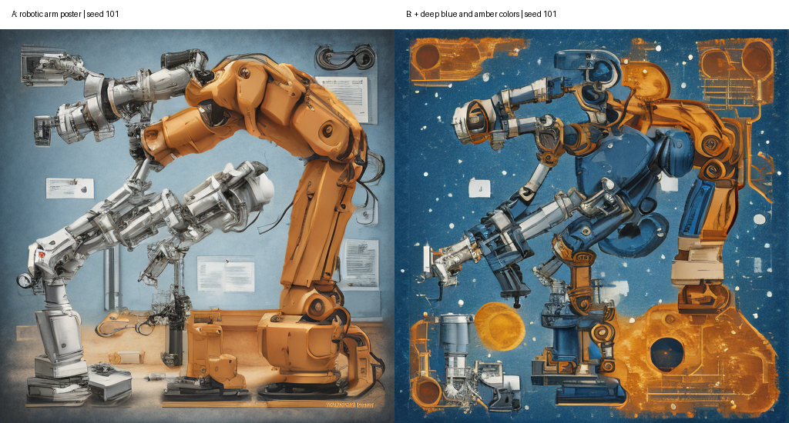

## Лабораторная работа №9
Промпт-инжиниринг

Вариант 3. Власюк Данил Витальевич
Группа Т26ИИКТ-МИК11
4 ноября 2026 года

## Цель и постановка

Проверить влияние одного элемента запроса на SD-Turbo и сравнить три приёма обращения к языковой модели. Контекст: афиша фестиваля робототехники. Сравниваются только исходный предмет и добавление цветовой палитры.

## Гипотеза до запуска

# ЛР9. Вариант 3. Предварительный протокол

Записано до запуска: 2026-11-04 (Europe/Moscow).
A: robotic arm poster
B: robotic arm poster, deep blue and amber colors
Цель CLIP: deep blue and amber colors.
Seed: 101,102,103,104,105; SD-Turbo, CPU float32, 512x512, 1 шаг, guidance_scale=0.
Гипотеза: добавление палитры повышает clip_target минимум на 1 пункт. Предмет должен оставаться узнаваемым; падение clip_subject более 1 пункта нежелательно. Для edge и contrast направление заранее не предполагается, практический допуск 10% среднего A. Эвристика |delta|>2s_A оценивается отдельно от допуска и не является формальным тестом значимости.
Часть 2: ожидается более высокое покрытие ограничений у few-shot и пошагового запроса; возможен потолок K1-K3. Три новых чата на каждый приём, сырые ответы сохраняются без исправлений. K4 описывает согласованность выбора, а не правильность.

## Методика

A: robotic arm poster. B: robotic arm poster, deep blue and amber colors. Текст-цель: deep blue and amber colors. Общие seed 101-105, размер 512×512, один шаг, guidance_scale=0, CPU float32. Учебные функции генерации и метрик сохранены без изменения. Критерий |Δ|>2s_A является эвристикой разброса, а не p-value. CLIP измеряет соответствие тексту, а не качество изображения.

## Результаты генерации

| Метрика | A | s_A | B | Δ | |Δ|/s | >2s |
| --- | --- | --- | --- | --- | --- | --- | --- | --- |
| clip_target | 9.3849 | 1.8552 | 15.2275 | 5.8426 | 3.1493 | да |
| clip_subject | 25.2426 | 1.7803 | 26.5309 | 1.2883 | 0.7236 | нет |
| edge | 0.0375 | 0.0025 | 0.0410 | 0.0036 | 1.4497 | нет |
| contrast | 0.1808 | 0.0056 | 0.1473 | -0.0335 | 5.9346 | да |
clip_target: допуск 1.0000, Δ=+5.8426; превышение допуска: True.

clip_subject: допуск 1.0000, Δ=+1.2883; превышение допуска: True.

edge: допуск 0.0037, Δ=+0.0036; превышение допуска: False.

contrast: допуск 0.0181, Δ=-0.0335; превышение допуска: True.

На seed101 в A крупная оранжевая механическая рука справа и несколько светлых манипуляторов слева стоят на серо-голубом фоне. В B фон заметно темнее и синее, оранжево-янтарные детали и декоративные элементы распределены по всему кадру. Палитра визуально изменилась в ожидаемом направлении, что согласуется с ростом clip_target.

Механические руки в B остаются узнаваемыми и занимают основную площадь, но композиция не стала изображением одного изолированного устройства: видны несколько манипуляторов и насыщенный декоративный фон. В обоих изображениях есть нечитабельные мелкие надписи и неправдоподобные детали. Это концепт, а не техническая иллюстрация реального оборудования. Названия производителей в запросы не вводились.

Субъективно B выглядит насыщеннее по цвету, хотя среднее стандартное отклонение яркости уменьшилось с 0,18077 до 0,14726: насыщенность цвета и контраст яркости - разные свойства. CLIP не является оценкой художественного или технического качества. Визуальное описание относится к seed101; численные выводы рассчитаны по всей серии 101-105.

Гипотеза роста clip_target минимум на 1 пункт подтверждена: Δ=+5,84265, |Δ|/s_A=3,149>2. Контроль clip_subject не ухудшился: Δ=+1,28828, однако 2s не превышено. Edge вырос на 9,59% - внутри допуска 10% и без превышения 2s. Contrast снизился на 18,54% - за пределами допуска и с превышением 2s; снижение не объявляется автоматически улучшением или ухудшением дизайна.

## Эксперимент с языковой моделью

Dia, стандартный чат без выбора модели, 04.11.2026. Точная базовая модель интерфейсом не сообщена. Девять новых чатов, без истории предыдущих повторов; поиск запрещён текстом учебного запроса. Использованы исходные build_prompt(zero/few/step,1). Пять описаний заказчика в каждом повторе. Полные тексты запросов приложены в prompts/, ответы в answers/. JSON zero/few скопирован кнопкой Copy code (без внешнего Markdown-ограждения), пошаговые ответы целиком кнопкой Copy as text; содержимое не исправлялось.

| Приём | Повторов | K1 | K2 | K3 | K4 |
| --- | --- | --- | --- | --- | --- |
| zero | 3 | 1.000 | 1.000 | 1.000 | 0.933 |
| few | 3 | 1.000 | 1.000 | 1.000 | 0.700 |
| step | 3 | 1.000 | 1.000 | 1.000 | 0.933 |
## Анализ и ограничения

K1 проверяет схему, K2 - подстрочное покрытие элементов, K3 - точное совпадение запретов; K4 оценивает согласованность style/composition между повторами. Потолок K1-K3 не означает эквивалентность методов на любых задачах. Различие K4 при трёх повторах и пяти описаниях предварительно; 30 сравнений на приём не независимы. Более сложный запрос сам по себе не гарантирует большей стабильности. Проверка подстрок допускает ложные совпадения и не заменяет смысловую оценку. Неизвестная базовая модель Dia ограничивает воспроизводимость.

## Паспорт среды

{
  "started": "2026-11-04T13:04:03+0000",
  "python": "3.11.11 (main, Mar 17 2025, 21:02:09) [Clang 20.1.0 ]",
  "platform": "Linux-6.8.0-136-generic-x86_64-with-glibc2.35",
  "packages": {
    "torch": "2.4.1+cpu",
    "diffusers": "0.32.2",
    "transformers": "4.57.6",
    "numpy": "2.1.3",
    "scipy": "1.15.2",
    "Pillow": "11.1.0"
  },
  "model": "stabilityai/sd-turbo",
  "revision": "b261bac6fd2cf515557d5d0707481eafa0485ec2",
  "clip": "openai/clip-vit-large-patch14",
  "clip_revision": "32bd64288804d66eefd0ccbe215aa642df71cc41",
  "seeds": [
    101,
    102,
    103,
    104,
    105
  ],
  "steps": 1,
  "guidance": 0.0,
  "size": 512,
  "device": "cpu",
  "source_sha256": "cc4d233de574e47a73d2126234ee0b8e9f5d80aa0ed6d4a2fac9748ac0f7b062"
}

Исходные скрипты и синтетические описания: приложенный src.zip. Ревизии SD-Turbo и CLIP закреплены учебной библиотекой и приведены выше. Веса не включаются в архив сдачи; сохраняются результаты и исходники. Запуск run_lr09.py всех 30 вариантов не требуется для индивидуального варианта: собственный сценарий выполняет те же функции для варианта 3.

## Ответы на контрольные вопросы

1. Пять seed позволяют увидеть разброс; один seed смешивает эффект запроса со случайным исходным шумом.
2. |Δ|>2s_A сравнивает среднюю разность с разбросом A. Практическая польза сравнивается с заранее заданным допуском; это разные условия, и 2s не является формальным тестом с заданным уровнем ошибки.
3. При guidance_scale=0 отрицательная ветвь не используется. Слова no people входят в обычное кодирование текста и могут даже привлечь людей вместо удаления.
4. Рост clip_target означает рост сходства с текстом в CLIP. Если глаз не видит изменения, вывод о визуальном улучшении не обоснован; нужно указать расхождение и ограничение метрики.
5. clip_subject контролирует сохранение предмета. В данном протоколе падение больше 1 пункта нежелательно, дополнительно проверяется узнаваемость руки.
6. Допустимо: в этой серии не найдено значимого роста детализации. Недопустимо: такие слова бесполезны для всех моделей и сцен.
7. K1 - корректность каждого объекта по схеме; K4 - согласованность style и composition между повторами. Разные правильные ответы могут иметь одинаково высокий K1 и низкий K4.
8. Новый чат убирает влияние предыдущих сообщений, примеров и исправлений. Общие настройки сервиса всё равно остаются возможным скрытым фактором.
9. Проверять соблюдение неуказанного ограничения некорректно: эксперимент измеряет не качество выполнения поставленной задачи. Все допустимые списки должны быть в запросе.
10. Три повтора и пять объектов - малая выборка. Попарные сравнения используют одни и те же ответы и потому не независимы; результат нельзя объявлять универсальным рейтингом приёмов.
11. Если базовая модель неизвестна, записываются сервис, видимый режим, дата и способ определения режима; название модели не придумывается. Здесь: Dia, стандартный чат, без ручного выбора базовой модели.

## Вывод

Выполнено сравнение запросов на пяти общих seed и трёх приёмов языковой модели по трём независимым чатам. Решение о влиянии палитры следует из таблицы и визуальной оценки, а практический эффект отделён от разброса seed. По языковой части вывод ограничен контекстом робототехники и режимом Dia на дату запуска.

## Комплект и источники

Архив ЛР09_Вариант_3_Сдача.zip: ноутбук, исходники, изображения, метрики, девять ответов, запросы, журнал, PDF и Markdown-отчёт. Источники: приложенные методические указания ЛР09; lab09_lib.py и lab09_llm.py из src.zip. Чужие демонстрационные числа не используются как собственные результаты.
